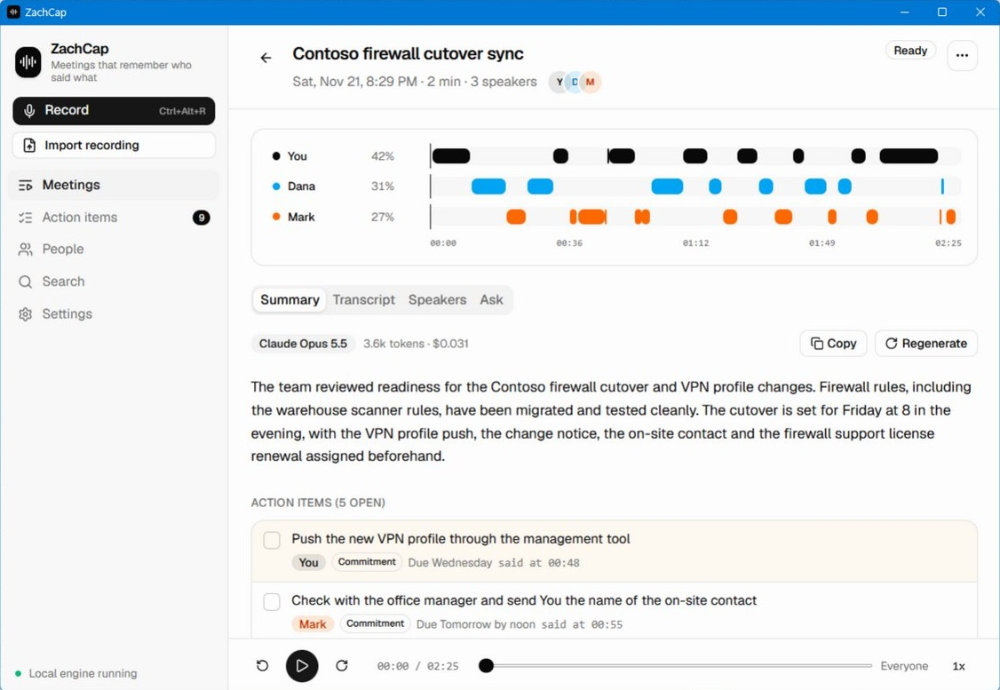
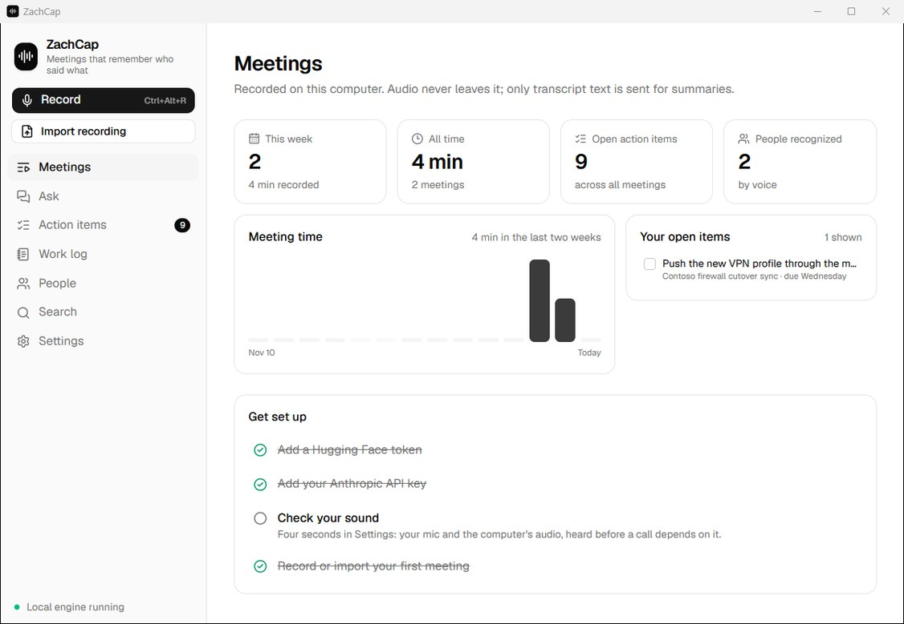
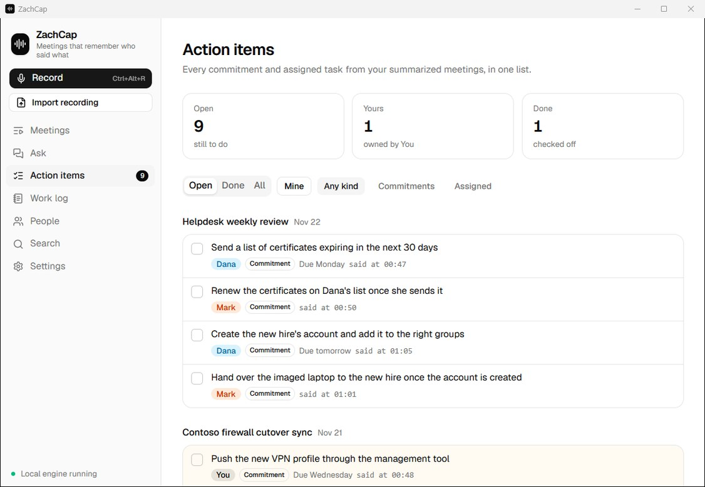

# ZachCap

**A local meeting recorder for Windows that knows who said what: it records any call, transcribes it on your own GPU, recognizes people by voice, and turns the meeting into decisions, action items and commitments.**

[](https://github.com/ZachGSnow/zachcap/actions/workflows/ci.yml)
[](LICENSE)



## Why

Most AI note takers join your call as a bot, read your calendar, or need an admin to approve an app in your Microsoft 365 tenant. Plenty of people can't do any of that, especially in meetings hosted by other companies. ZachCap needs none of it: it records your microphone and your computer's audio on your own machine, works with Teams, softphones or anything else that plays through your speakers, and keeps the audio on that machine.

Teams mixes every remote voice into one stream, so ZachCap separates speakers itself and learns their voices: name someone once and they are labeled automatically in later meetings.

## Features

- **Record any call** with one button or **Ctrl+Alt+R** from anywhere; the app lives in the tray and can start with Windows. It notices when Teams or another app starts using your microphone and offers to record.
- **Import recordings** you already have (a Teams .mp4, .m4a, .mp3, .wav...), with an optional time range.
- **Transcription on your GPU** with Whisper (`large-v3-turbo`): about 2-3 minutes per hour of audio on a 4 GB laptop GPU.
- **Speaker separation and voice recognition**: a "Who's this?" card plays a short sample of each unknown voice; name them once and ZachCap recognizes them next time, including you on your own mic and people in the room with you.
- **Speaker lanes**: a timeline of who talked when, with talk-time stats, and **solo playback** that plays one person only, from their own side of the call.
- **Summaries with names** from Claude (Opus 5.5 by default): overview, decisions, action items marked as commitments or assignments with due dates, who said what, open questions and topics. Every item links to the moment it was said.
- **Action item tracker** across all meetings, with Open/Done, "Mine", and commitments vs assigned tasks.
- **Ask a meeting**: questions answered from the transcript with clickable timestamps.
- **History and search**: every meeting, searchable by anything anyone said.
- **Fix anything**: rename people (renaming to an existing name merges them), move one line to another speaker, forget a voice, rename or delete a meeting.

| | |
|---|---|
|  |  |
|  | |

## Quick start

Requirements: Windows 10 or 11, an NVIDIA GPU with 4 GB or more (it falls back to the CPU, slowly), [uv](https://docs.astral.sh/uv/), Node.js LTS, and Rust with the Visual Studio C++ build tools.

```powershell
git clone https://github.com/ZachGSnow/zachcap.git
cd zachcap\engine
uv sync                      # Python 3.12 and the GPU speech stack (a few GB)

cd ..\apps\desktop
npm install
npm run tauri dev            # starts the local engine and opens the app
```

Then open **Settings** and add:

1. A free [Hugging Face](https://huggingface.co) token, after accepting the terms of [pyannote/speaker-diarization-community-1](https://huggingface.co/pyannote/speaker-diarization-community-1). Without it ZachCap still transcribes, labeling the two sides "You" and "Call audio".
2. An [Anthropic API key](https://platform.claude.com) for summaries and questions (optional; about $0.09 per hour-long meeting with Opus 5.5).

Keys are stored in Windows Credential Manager. The engine also has a command line (`uv run zachcap --help`): `record`, `import`, `show`, `name`, `confirm`, `search`, `keys`.

## Configuration

Everything is set in the app under **Settings**:

| Setting | What it does | Default |
|---|---|---|
| Your name | How your own lines appear in transcripts and summaries | You |
| Microphone | Your voice; pick the one your meeting app uses | Windows default |
| Computer audio from | The output device to record (speakers, headset, or a virtual cable) | Windows default |
| Language | Whisper's language, or automatic detection | English |
| Claude model | Opus 5.5, Sonnet 5.5 or Fable 5.1 | Opus 5.5 |
| API keys | Hugging Face token and Anthropic key | not set |
| Start with Windows | Opens ZachCap in the tray when you sign in (release builds) | off |

Environment variables for development: `ZACHCAP_HOME` (data folder, default `%LOCALAPPDATA%\ZachCap`), `ZACHCAP_ENGINE_DIR` (engine location for the desktop app).

## How it works

```
mic + speaker loopback (WASAPI)
  -> two tracks, written as crash-safe FLAC chunks
  -> Whisper large-v3-turbo on the GPU: timed words per track
  -> pyannote community-1: who spoke when, one voice embedding per speaker
  -> words joined to speakers; mic lines that echo the call are dropped
  -> embeddings matched against saved voiceprints (cosine; 0.75 auto, 0.60 suggest)
  -> SQLite with full-text search
  -> Claude: summary, action items, commitments (transcript text only)
```

The desktop app is Tauri 2 (React, TypeScript, Tailwind, shadcn/ui). It starts the Python engine on 127.0.0.1 with a random per-launch token, and the engine exits if the app goes away. See [docs/PLAN.md](docs/PLAN.md) for the design, decisions and measurements.

## Your data and privacy

- **What is stored:** recordings (FLAC), transcripts, summaries, action items, people and voiceprints (voice embeddings plus the speaker's sample times), in `%LOCALAPPDATA%\ZachCap`. Files and the SQLite database are not encrypted beyond what Windows provides (use BitLocker).
- **What leaves the machine:** only when you ask for a summary or a question, the transcript text goes to Anthropic's API with your key. Audio and voiceprints never leave. Model files are downloaded once from Hugging Face. pyannote's usage telemetry is switched off.
- **Deleting:** deleting a meeting removes its audio, transcript, summary, action items and the voice samples learned from it. "Forget voice" removes a person's voiceprint. Deleting is a normal file delete, not a secure erase.
- **Consent:** voiceprints count as biometric data in some places (for example Illinois), and recording laws differ; some require everyone's consent. Tell people you are recording and follow your organization's policy.

## Testing

```powershell
cd engine
uv run pytest -q             # 32 tests: storage, matching, audio import, API, summaries
cd ..\apps\desktop
npx tsc --noEmit; npx vite build
```

Verified on a Windows 11 laptop with an RTX A500 (4 GB), November 2026:

| What | Result |
|---|---|
| Mic + loopback capture | Works; continuous loopback, no gaps in silence |
| Whisper large-v3-turbo, batched | 29.7x real time (2 min per meeting hour), 2.3 GB GPU |
| Speaker separation (pyannote) | 37-minute real Teams recording in about 4 minutes after a fix for a cuDNN workspace spill on 4 GB GPUs |
| Voice recognition across meetings | On that recording split into halves: the returning speaker was recognized automatically (0.96); same person scored 0.88-0.96, different people 0.07-0.52 |
| Claude summaries, Ask | Opus 5.5, Sonnet 5.5 and Fable 5.1 against a synthetic meeting |

Not verified yet: a live two-track recording of a real Teams call (capture was tested with played audio), call detection with a real call (tested against a simulated registry), and echo handling on hardware without built-in echo cancellation. Test audio in the repo is synthetic (Windows text-to-speech, see `engine/scripts/make_meeting.py`); no real recordings are committed.

## Roadmap

- Live transcript during the call
- Capture one app only (process loopback) instead of all computer audio
- Ask across all meetings; weekly digest of open commitments
- Signed installer with automatic updates

## License

[MIT](LICENSE) © Zach Snow
