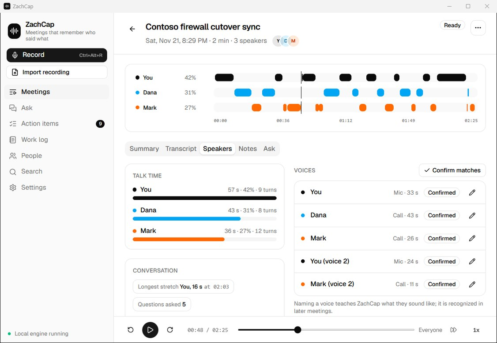

# ZachCap

**A local meeting recorder for Windows that knows who said what: it records any call, transcribes it on your own GPU, recognizes people by voice, and turns the meeting into decisions, action items and commitments.**

[](https://github.com/ZachGSnow/zachcap/actions/workflows/ci.yml)
[](LICENSE)


## Why

Most AI note takers join your call as a bot, read your calendar, or need an admin to approve an app in your Microsoft 365 tenant. Plenty of people can't do any of that, especially in meetings hosted by other companies. ZachCap needs none of it: it records your microphone and your computer's audio on your own machine, works with Teams, softphones or anything else that plays through your speakers, and keeps the audio on that machine.

Teams mixes every remote voice into one stream, so ZachCap separates speakers itself and learns their voices: name someone once and they are labeled automatically in later meetings.

## Features

- **Record any call** with one button or **Ctrl+Alt+R** from anywhere; the app lives in the tray and can start with Windows. **Calls record themselves**: when Teams, 3CX or another call app you choose takes your microphone, recording starts at once and stops a few seconds after the call ends (under a minute with nobody on the other end, like a mic test, isn't kept unless you added a note, and Don't record deletes it). Other apps using the mic, a call in a web browser say, get an offer to record instead. The other side is recorded from **every speaker and headset at once**, so a call on a headset that isn't the Windows default, or a headset plugged in mid-call, isn't lost. While it records it warns about a muted mic, a call with no call audio and a nearly full disk, keeps the PC from going to sleep, and when the call ends it **counts down and stops** (Keep recording calls it off).
- **Notes and bookmarks while you record**: type a note in the recording bar, or press **Ctrl+Alt+B** to bookmark the moment. **Ctrl+Alt+S snapshots the call**: a picture of the call window (the window in front, or the call app's own window when you click the camera in ZachCap) and the text Windows reads in it (an error message, a hostname, a slide), read on this computer and kept with the meeting's notes. A window that keeps itself out of screenshots is left alone. Both keys are held only while recording, and every shortcut's keys can be changed in Settings, which says when another app has registered the same keys. They appear on the meeting's timeline, and summaries make sure to cover them. **Pause** privately: nothing is recorded until you resume, and the tracks stay in sync.
- **A live panel during calls**: a small window over the call shows what's being said a moment after each person stops talking (you by name, the others as Call), with the recording's clock. It's left out of screen shares and screenshots, doesn't take the keyboard from the call, and its X closes it for that call (the Captions button in the recording bar brings it back). It's a rough draft to glance at: the transcript kept with the meeting is still made after the call, and nothing of the live one is saved. It runs on the GPU, giving way to a meeting being transcribed, or on half the CPU's cores when there's no GPU; whatever goes wrong with it, the recording carries on.
- **Nothing lost to a crash**: the meeting is saved from its first second. If ZachCap is quit mid-call, crashes, or Windows restarts, the audio recorded so far is recovered and processed at the next start.
- **Import recordings** you already have (a Teams .mp4, .m4a, .mp3, .wav..., up to 12 hours and 8 GB), with an optional time range, or pick a **watch folder** and recordings saved there (a softphone's or phone system's exports) import themselves: each version of a file once, and ZachCap only ever reads them. A file in use or on a mapped network drive that's offline is tried again on its own; one that isn't a recording ZachCap can read, or that ZachCap stopped while reading, is listed in Settings, with a Retry. A file is read only as one of those kinds, whatever its name, so a playlist renamed .mp3 can't make ZachCap open other files, and in a process of its own with a time limit, so a damaged or crafted file that crashes or hangs the decoder gets a reason like any other file ZachCap can't read, and ZachCap carries on. For a folder on a server, map the share to a drive letter in File Explorer first: network paths (`\\server\share`) aren't used.
- **Transcription on your GPU** with Whisper (`large-v3-turbo`): about 2-3 minutes per hour of audio on a 4 GB laptop GPU. **Words to know** (names, products, jargon, and what Whisper mishears them as) are spelled your way, and so are the names of people you've identified.
- **Speaker separation and voice recognition**: a "Who's this?" card plays a short sample of each unknown voice; name them once and ZachCap recognizes them next time, including you on your own mic and people in the room with you.
- **Speaker lanes**: a timeline of who talked when, with talk-time stats, and **solo playback** that plays one person only, from their own side of the call. Listening back can **skip silences**, with video-player keys (Space or K, J and L, arrows). **Where your name was said** is marked on the timeline and the meeting list, and the transcript can show just those lines. **Conversation stats** show each person's pace, longest stretch, questions asked, and how often they talked over the other side.
- **Summaries with names** from Claude (Opus 5.5 by default): overview, decisions, action items marked as commitments or assignments with due dates, who said what, open questions and topics. Every item links to the moment it was said. Pick the **kind of meeting** (1:1, standup, customer call, project status, incident or troubleshooting, interview) to set what the summary focuses on, or leave it on **Automatic**: a title that names the kind, a client, or just you and one other person settles it for free, and otherwise Claude Haiku reads the start of the transcript and picks (under a tenth of a cent). **Edit them or add your own** in Settings (a vendor call, a client's quarterly review).
- **Write from a meeting** in one click: a follow-up email, a status update, or notes for a service ticket, ready to copy. Edit these or add your own documents (a client's ticket format, a time entry). Edit the result, or **ask for a change** ("shorter, for the client") and Claude rewrites it from the meeting.
- **Action item tracker** across all meetings, with Open/Done, "Mine", and commitments vs assigned tasks.
- **Dictation in any app** (optional): hold **Ctrl+Alt+D**, speak, let go, and what you said is typed where your cursor is, spelled with your Words to know: ticket notes, replies, chat. Transcribed on this computer by a small model on the CPU, so it works during a call and never waits for the GPU; nothing is recorded or kept. It's only typed into the window you were in when you let go, and never presses Enter: if you've moved to another window by then, it's copied instead, ready to paste (and kept out of clipboard history). During a recording, what you dictate is left out of the meeting; the call app still hears you, so mute it first. Windows doesn't allow dictation into apps run as administrator. Filler sounds (um, uh) are left out of English dictation, and saying "scratch that" takes back the sentence before it, all on this PC. **Snippets**: say just a cue ("reboot note") and the text you saved for it is typed instead. Settings lists your last few dictations, so one that went somewhere else can be copied again; they're kept in memory only, until ZachCap closes.
- **Work log** for a day or a week: each meeting with who was there, what came of it and its action items, plus a **draft time entry** per meeting rounded up to 15 minutes, ready to copy into a time sheet or ticket. Built from your summaries, free and instant; it can also be kept in the export folder, and Ask and the MCP server can read it.
- **Tickets**: tell ZachCap how your ticket numbers look (`#######` for a 7-digit number, `INC-####`) and it finds them in a meeting's title, your notes, its snapshots and what was said. One you wrote or snapshotted becomes the meeting's ticket; ones only heard are offered to pick. The ticket shows in the meeting list, goes into time entries, ticket notes and exports, finds the meeting in search, and Ask and the MCP server can list a ticket's meetings.
- **Clients**: say which client each person works for (on the People page), and their meetings are that client's; set a meeting's client yourself when it was with someone new or with two clients. The client shows in the meeting list and header, the meeting list and the work log can be narrowed to one client (a per-client time sheet), and exports, ticket notes, Ask and the MCP server know it.
- **Topics**: track words and phrases across meetings ("Renewals: renewal, contract, quote"). Each meeting shows the topics said in it, and a filter on its transcript marks those lines; the Topics page lists where each came up, with the client; the work log notes each meeting's topics. Found on this PC with the full-text index.
- **Attach files to a meeting**: a log, an exported email (.eml), a config or any text file, from the Notes tab. Its text is kept with the meeting (the file is only read), so summaries, ticket notes and Ask can use the exact error codes and the email that led to the call; it goes to Claude only with the meeting, labelled as someone else's text and masked like your notes. A ticket number in a file is offered, never filled in on its own.
- **Ask across all your meetings**: "What did I commit to this week?", "What's still open with Dana?". Claude searches your transcripts, summaries and action items with read-only tools and links every fact to the moment it was said. **Brief me** on a person prepares you for your next meeting with them. Each meeting also has its own Ask tab.
- **History and search**: every meeting, searchable by anything anyone said.
- **Your meetings in Claude Code or the Claude app**: a read-only MCP server (`zachcap mcp`) lets Claude search your transcripts and read summaries, action items and notes. Settings has the command and config to copy.
- **Export** a meeting as Markdown (summary, action items, your notes, transcript), plain text or subtitles (.srt). An optional **export folder** keeps a Markdown copy of every meeting up to date, for Obsidian or any notes folder.
- **Fix anything**: rename people (renaming to an existing name merges them), move one line to another speaker, fix a line's words (double-click it; a misheard name or term is offered for Words to know, so later meetings get it right), forget a voice, rename or delete a meeting.
- **Redact a moment**: when a password or a code was read aloud, silence that stretch of the recording on both sides of the call and remove what was said from the transcript and search.

| | |
|---|---|
|  |  |
|  |  |

## Quick start

### Install

Requirements: Windows 10 or 11 (64-bit), an internet connection for the first start, and about 8 GB of free disk space. An NVIDIA GPU with 4 GB or more makes processing fast; without one ZachCap runs on the CPU, more slowly.

1. Download `ZachCap_<version>_x64-setup.exe` from the [latest release](https://github.com/ZachGSnow/zachcap/releases/latest) and run it. It installs for your account only (no administrator rights), into `%LOCALAPPDATA%\Programs\ZachCap`. The installer isn't code-signed yet, so Windows SmartScreen may say it "protected your PC": choose **More info**, then **Run anyway**.
2. Start ZachCap. The first start sets up the speech engine: it downloads Python and the speech libraries (a few GB) and takes a few minutes; later starts take seconds.
3. Open **Settings** and add:
   1. A free [Hugging Face](https://huggingface.co) token, after accepting the terms of [pyannote/speaker-diarization-community-1](https://huggingface.co/pyannote/speaker-diarization-community-1). Without it ZachCap still transcribes, labeling the two sides "You" and "Call audio".
   2. An [Anthropic API key](https://platform.claude.com) for summaries and questions (optional; about $0.09 per hour-long meeting with Opus 5.5).

Keys are stored in Windows Credential Manager. Your meetings, voices and settings live in `%LOCALAPPDATA%\ZachCap`; uninstalling (Settings > Apps) removes the program and its speech engine but leaves them. Updating is running a newer installer: it keeps the speech engine and downloads only what changed.

Windows **Smart App Control**, when it is on, blocks parts of the speech libraries (they aren't signed by their makers), and the engine can't start. If the startup screen reports that, Smart App Control has to be turned off (Windows Security > App & browser control).

### Build from source

Requirements: [uv](https://docs.astral.sh/uv/), Node.js LTS, and Rust with the Visual Studio C++ build tools.

```powershell
git clone https://github.com/ZachGSnow/zachcap.git
cd zachcap\engine
uv sync                      # Python 3.12 and the GPU speech stack (a few GB)

cd ..\apps\desktop
npm install
npm run tauri dev            # starts the local engine and opens the app
```

The engine also has a command line (`uv run zachcap --help`): `record`, `import`, `show`, `name`, `confirm`, `search`, `keys`, `mcp`.

To build the installer, from the repo root:

```powershell
powershell -NoProfile -ExecutionPolicy Bypass -File apps\desktop\scripts\build-installer.ps1
```

It copies the engine's tracked files and uv (a pinned release, checked against its SHA-256) into the installer, and prints the installer's path and SHA-256. Turn on **Start with Windows** in Settings to have ZachCap waiting in the tray; the engine's log is `engine.log` in the data folder.

## Configuration

Everything is set in the app under **Settings**:

| Setting | What it does | Default |
|---|---|---|
| Your name | How your own lines appear in transcripts and summaries | You |
| Also answer to | Other names people call you (a nickname, initials), for marking where your name was said | empty |
| Microphone | Your voice; pick the one your meeting app uses | Windows default |
| Computer audio from | Every speaker and headset at once, the Windows default only, or one device (or a virtual cable) | Every speaker and headset |
| Language | Whisper's language, or automatic detection | English |
| Words to know | Terms to spell right, one per line; `Term: misheard, misheard` adds corrections | empty |
| Claude model | Opus 5.5, Sonnet 5.5 or Fable 5.1 | Opus 5.5 |
| Usual kind of meeting | What summaries focus on unless a meeting says otherwise; Automatic picks one for each meeting | Automatic (a usual kind chosen before is kept) |
| Kinds of meeting, one-click documents | Edit the built-in ones (and reset them), or add your own with your own instructions | As shipped |
| API keys | Hugging Face token and Anthropic key | not set |
| Start with Windows | Opens ZachCap in the tray when you sign in (release builds) | off |
| Dictation | Hold Ctrl+Alt+D in any app to type what you say | off |
| Snippets | For dictation: `cue: text to type`, one per line; saying just a cue types its text | empty |
| Shortcuts | New keys for start or stop recording, bookmark, snapshot and dictate: click the keys and press new ones (two of Ctrl, Alt and Win, or Win, with a letter, digit or F key; F13-F24 alone). Settings says when another app has registered the same keys (they never reach ZachCap then); apps that read keys with a hook of their own can't be seen | Ctrl+Alt+R, B, S and D |
| Sound check | Four seconds recorded as a meeting would be, with a short sound halfway, played where the computer's audio is recorded from (a quiet tone on a chosen output device): shows your mic and the computer's audio are both heard (nothing is kept) | - |
| Record calls on their own | Start recording when a chosen call app takes the mic: Microsoft Teams, 3CX, Zoom, Webex, RingCentral (Slack and Discord when picked; never a web browser). These recordings always stop when their call ends | on |
| Live panel during calls | A small panel over the call with what's being said, a moment after each person stops talking; left out of screen shares and screenshots. Uses the GPU, or the CPU when there's none. Off stops it at once; on starts it with the next recording | on with an NVIDIA GPU, else off |
| Stop when the call ends | For recordings you start: stop a few seconds after the call app lets go of the mic and nobody has spoken for ten seconds, or a minute after ten quiet minutes | on |
| Theme | Light, dark, or the same as Windows | Same as Windows |
| Export folder | Keeps a Markdown copy of every meeting in a folder you choose, one file per meeting, named with its id (M12) | off |
| Work logs there too | Also keeps a daily and a weekly work log in the export folder | off |
| Watch folder | Recordings saved in this folder import themselves within a minute; turning it on asks about the ones already there | off |
| Ticket numbers look like | Patterns for your ticket numbers: `#` a digit, `?` a letter, anything else itself, several separated by commas (`#######, INC-####`) | off |
| Topics | Words and phrases to track, one topic per line: `Name: word, phrase` | empty |

Environment variables for development: `ZACHCAP_HOME` (data folder, default `%LOCALAPPDATA%\ZachCap`), `ZACHCAP_ENGINE_DIR` (engine location for the desktop app).

## How it works

```
mic + loopback of every output device (WASAPI, mixed by packet time)
  -> two tracks, written as crash-safe FLAC chunks
  -> Whisper large-v3-turbo on the GPU: timed words per track
  -> pyannote community-1: who spoke when, one voice embedding per speaker
  -> words joined to speakers; mic lines that echo the call are dropped
  -> embeddings matched against saved voiceprints (cosine; 0.75 auto, 0.60 suggest)
  -> SQLite with full-text search
  -> Claude: summary, action items, commitments (transcript text only)
```

The desktop app is Tauri 2 (React, TypeScript, Tailwind, shadcn/ui). It starts the Python engine on 127.0.0.1 with a random per-launch token, and the engine exits if the app goes away. See [docs/PLAN.md](docs/PLAN.md) for the design, decisions and measurements.

## Your data and privacy

- **What is stored:** recordings (FLAC), transcripts, summaries, action items, people and voiceprints (voice embeddings plus the speaker's sample times), in `%LOCALAPPDATA%\ZachCap`. Files and the SQLite database are not encrypted beyond what Windows provides (use BitLocker).
- **What leaves the machine:** only when you ask for a summary or ask a question, the transcript text it needs goes to Anthropic's API with your key (for a question across meetings, the lines, summaries and action items Claude looks up). That text includes the meeting's title, its client and ticket number, and for a document you're changing, your edits; "mask contact details" covers email addresses, phone numbers and card numbers, not client names. If you add the MCP server to a Claude app, what it looks up goes to that app. Dictation never sends anything. Audio and voiceprints never leave. Model files are downloaded once from Hugging Face. pyannote's usage telemetry is switched off.
- **Deleting:** deleting a meeting removes its audio, transcript, summary, action items and the voice samples learned from it. "Forget voice" removes a person's voiceprint. **Keep recordings** (Settings) deletes audio and snapshot pictures after 7, 30, 90 or 365 days and keeps the transcript, summary and notes (a snapshot's text included). **Redact a moment** silences part of a recording and removes its words from the transcript, the search index and the database files. Deleting and redacting are normal file operations, not a secure erase: the disk may keep old copies until they are overwritten.
- **Masking:** an option replaces emails, phone numbers and card numbers with placeholders in everything sent to Claude, including through the MCP server.
- **Consent:** voiceprints count as biometric data in some places (for example Illinois), and recording laws differ; some require everyone's consent. Tell people you are recording (the recording bar copies a heads-up for the meeting chat) and follow your organization's policy.

## Testing

```powershell
cd engine
uv run pytest -q             # 320 tests: storage, matching, audio, capture and mixing, the recording watch, crash recovery, API, summaries and templates, Ask, redaction, work logs, snapshots, mentions, the watch folder, dictation, shortcuts, tickets, clients, topics
cd ..\apps\desktop
npm test                     # the page's own logic: keys from a key press, times
npx tsc --noEmit; npx vite build
cd src-tauri
cargo test --lib             # the shell: the dictation keys' hook, keys in both parsers
```

Verified on a Windows 11 laptop with an RTX A500 (4 GB), November 2026:

| What | Result |
|---|---|
| Mic + loopback capture | Works; continuous loopback, no gaps in silence |
| Whisper large-v3-turbo, batched | 29.7x real time (2 min per meeting hour), 2.3 GB GPU |
| Speaker separation (pyannote) | 37-minute real Teams recording in about 4 minutes after a fix for a cuDNN workspace spill on 4 GB GPUs |
| Voice recognition across meetings | On that recording split into halves: the returning speaker was recognized automatically (0.96); same person scored 0.88-0.96, different people 0.07-0.52 |
| Claude summaries, Ask | Opus 5.5, Sonnet 5.5 and Fable 5.1 against a synthetic meeting |

Not verified yet: a live two-track recording of a real Teams call (capture was tested with played audio), a second output device (a headset plugged in mid-call; the mixing is unit-tested), call detection with a real call (tested against a simulated registry), and echo handling on hardware without built-in echo cancellation. Test audio in the repo is synthetic (Windows text-to-speech, see `engine/scripts/make_meeting.py`); no real recordings are committed.

## Roadmap

Researched and planned in [docs/PLAN.md](docs/PLAN.md#13-next-from-competitor-research-2026-11-23):

- Record every speaker and headset, so a call on a non-default device or a mid-call switch isn't lost
- Capture health warnings, keeping the PC awake while recording, and a smart stop when the call ends
- Your own summary templates and one-click documents; redact a moment (a password read aloud); fix a line's words
- A daily and weekly digest with draft time entries; markers where your name was said; a watch folder for recordings
- Later: a "ticket note" dictation mode that tidies what you said with Claude, live transcript, signed installer

## License

[MIT](LICENSE) © Zach Snow
