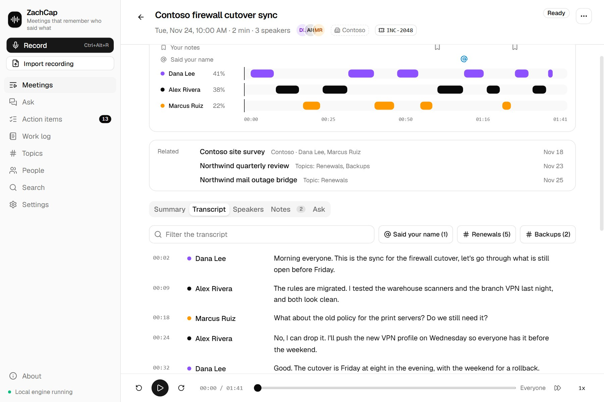
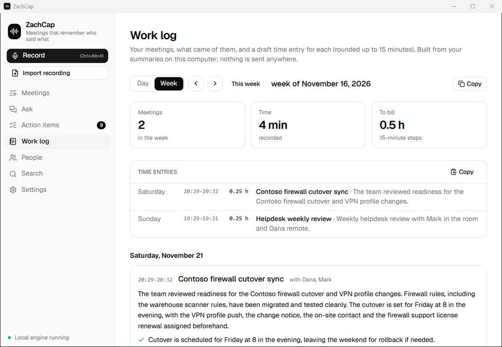
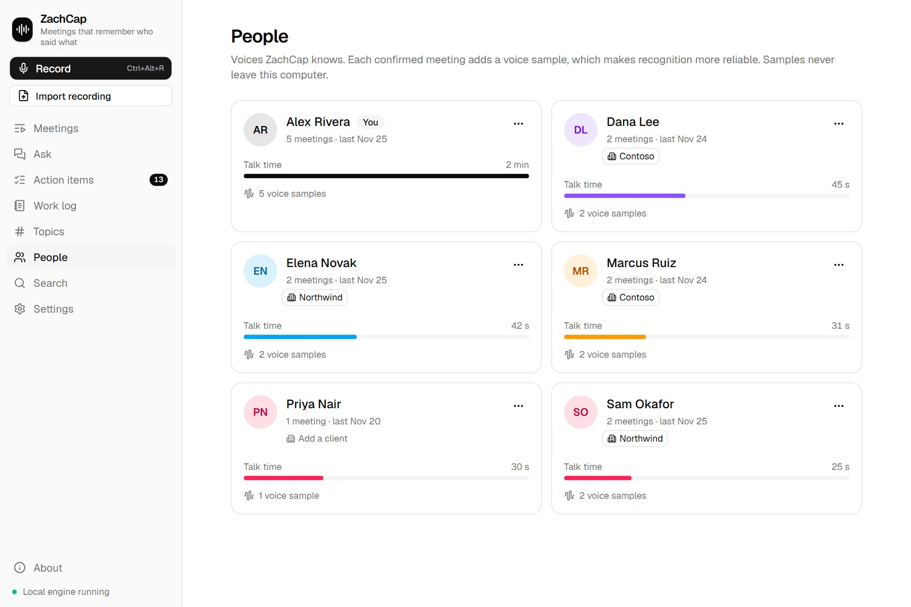

# ZachCap

**A local meeting recorder for Windows that knows who said what: it records any call, transcribes it on your own PC, recognizes people by voice, and turns the meeting into decisions, action items and commitments.**

[](https://github.com/ZachGSnow/zachcap/actions/workflows/ci.yml)
[](https://github.com/ZachGSnow/zachcap/releases/latest)
[](LICENSE)

**[Download](https://github.com/ZachGSnow/zachcap/releases/latest)** | **[Setup guide](docs/SETUP.md)** | [Features](docs/FEATURES.md) | [How it works](docs/ARCHITECTURE.md) | [Changelog](CHANGELOG.md)

<picture>
  <source media="(prefers-color-scheme: dark)" srcset="docs/images/meeting-dark.jpg">
  
</picture>

## Why

Most AI note takers join your call as a bot, read your calendar, or need an admin to approve an app in your Microsoft 365 tenant. Plenty of people can't do any of that, especially in meetings hosted by other companies. ZachCap needs none of it: it records your microphone and your computer's audio on your own machine, works with Teams, softphones or anything else that plays through your speakers, and keeps the audio on that machine.

Teams mixes every remote voice into one stream, so ZachCap separates speakers itself and learns their voices: name someone once and they are labeled automatically in later meetings.

## Features

- **Records any call** in Teams, Zoom, 3CX or anything else that plays through your speakers, from every speaker and headset at once. Calls can record themselves and stop when they end.
- **Knows who is talking.** Name a voice once and it is recognized in later meetings, you included. Brief background voices are left out.
- **Transcribes on your PC** with Whisper, on an NVIDIA GPU or the CPU, spelling your names and jargon your way. A live panel shows what is being said during the call.
- **Summaries with names:** decisions, action items with due dates, commitments and open questions, each linked to the moment it was said. By Claude with your own key, or by a model on your PC through Ollama.
- **Work from them:** an action item tracker, a work log with draft time entries, follow-up emails and ticket notes, clients, tickets and topics.
- **Find anything:** full-text search, related meetings, and questions across every meeting. A read-only MCP server brings your library to Claude Code or Claude Desktop.
- **Sends to ZachCore, if you want:** each meeting's summary, tasks and facts become a note in your own ZachCore server, and come back out when a meeting is made private, deleted or redacted. Off until you turn it on.
- **Private by design:** audio never leaves the PC, private meetings are never sent anywhere, a spoken password can be redacted, and nothing is lost to a crash.
- **Dictation** in any app: hold Ctrl+Alt+D, speak, let go.

Each in detail: [docs/FEATURES.md](docs/FEATURES.md).

| | |
|---|---|
|  |  |
| **Transcript**, linked to the recording | **Speakers**: talk time, voices, conversation stats |
|  |  |
| **Action items** across every meeting | **Work log** with draft time entries |
|  |  |
| **People** it recognizes | **Home** |

Every picture shows sample data.

## Quick start

1. **Install.** Download `ZachCap_<version>_x64-setup.exe` from the [latest release](https://github.com/ZachGSnow/zachcap/releases/latest) and run it (no administrator rights). It isn't code-signed yet: if SmartScreen stops it, choose **More info**, then **Run anyway**. The first start downloads about 4 GB.
2. **Get a free Hugging Face token**, so it can tell speakers apart: accept the [speaker model's conditions](https://huggingface.co/pyannote/speaker-diarization-community-1), create a **Read** [token](https://huggingface.co/settings/tokens), and paste it under **Settings > API keys**.
3. **Optional: summaries.** An [Anthropic API key](https://platform.claude.com) in the same place (about $0.09 per hour-long meeting), or [Ollama](https://ollama.com) for a model on your PC.
4. **Run the sound check** in Settings, and decide whether calls should record themselves. They do by default in Teams, 3CX, Zoom, Webex and RingCentral.

Step by step, with troubleshooting: **[docs/SETUP.md](docs/SETUP.md)**.

**Requirements:** Windows 10 or 11 (64-bit) and about 8 GB of disk. An NVIDIA GPU with 4 GB or more is optional: with one, an hour-long meeting takes about 10 minutes to process; on a 6-core laptop CPU, about an hour in the background. Windows Smart App Control must be off.

## Configuration

Everything is in the app under **Settings**. The ones worth knowing first:

| Setting | What it does | Default |
|---|---|---|
| Record calls on their own | Starts when a chosen call app takes the mic, stops when the call ends | On |
| API keys | Hugging Face token and Anthropic key, kept in Windows Credential Manager | Not set |
| Written by | Claude, or a model on this PC | Claude |
| Leave out brief voices | Unnamed voices under this share of the talk aren't listed | 5% |
| Words to know | Names and jargon to spell right | Empty |
| Mask contact details for Claude | Replaces emails, phone and card numbers | Off |
| Keep recordings | Deletes audio after a time, keeps the text | Forever |
| ZachCore | Sends meetings to your own ZachCore server: the summary, tasks and facts, the transcript if you turn it on | Off |

All of them: [docs/SETTINGS.md](docs/SETTINGS.md).

## How it works

```
mic + loopback of every output device (WASAPI, mixed by packet time)
  -> two tracks, written as crash-safe FLAC chunks
  -> Whisper large-v3-turbo on the GPU: timed words per track
  -> pyannote community-1: who spoke when, one voice embedding per speaker
  -> words joined to speakers; mic lines that echo the call are dropped
  -> embeddings matched against saved voiceprints (cosine; 0.75 auto, 0.60 suggest)
  -> SQLite with full-text search
  -> Claude: summary, action items, commitments (transcript text only)
```

The desktop app is Tauri 2 (React, TypeScript, Tailwind, shadcn/ui). It starts a Python engine on 127.0.0.1 with a random token per launch. Design, security and measurements: [docs/ARCHITECTURE.md](docs/ARCHITECTURE.md).

## Your data and privacy

- **What is stored:** recordings (FLAC), transcripts, summaries, action items, people and voiceprints (voice embeddings plus the speaker's sample times), in `%LOCALAPPDATA%\ZachCap`. Files and the SQLite database are not encrypted beyond what Windows provides (use BitLocker).
- **What leaves the machine:** only when you ask for a summary or ask a question, the transcript text it needs goes to Anthropic's API with your key (for a question across meetings, the lines, summaries and action items Claude looks up). That text includes the meeting's title, its client and ticket number, and for a document you're changing, your edits; "mask contact details" covers email addresses, phone numbers and card numbers, not client names. If you add the MCP server to a Claude app, what it looks up goes to that app. A meeting made private is never part of any of this (what Claude was sent before that stays sent). What the model on this PC writes goes nowhere: ZachCap asks Ollama at 127.0.0.1 only, without a proxy. Dictation never sends anything. Audio and voiceprints never leave. Model files are downloaded once from Hugging Face. pyannote's usage telemetry is switched off.
- **Sending to ZachCore:** off until you turn it on in Settings. Then each meeting recorded from then on (older ones only when you send them) goes as text to the ZachCore server whose address you set, over https (plain http only to this PC), with the key saved for that address in Windows Credential Manager: half a minute after the meeting last changed, and again with each change. It sends the meeting's title, time, client and ticket, who was there and how much each of you talked, and what the switches allow: the summary and your notes, the tasks, lasting facts about the people and the client, and the transcript (off at first). Audio, voice samples, snapshots, attached files and dictation never go, nor does a private meeting or one of a client you set to never. A meeting made private, deleted or redacted after it went is taken back from ZachCore, also while sending is off; turning sending off takes nothing back, Take back does.
- **Deleting:** deleting a meeting removes its audio, transcript, summary, action items and the voice samples learned from it. "Forget voice" removes a person's voiceprint. **Keep recordings** (Settings) deletes audio and snapshot pictures after 7, 30, 90 or 365 days and keeps the transcript, summary and notes (a snapshot's text included). **Redact a moment** silences part of a recording and removes its words from the transcript, the search index and the database files. Deleting and redacting are normal file operations, not a secure erase: the disk may keep old copies until they are overwritten.
- **Masking:** an option replaces emails, phone numbers and card numbers with placeholders in what Claude gets from your meetings and in your questions, including through the MCP server. Your own kinds of meeting and documents are sent as you wrote them.
- **Consent:** voiceprints count as biometric data in some places (for example Illinois), and recording laws differ; some require everyone's consent. Tell people you are recording (the recording bar copies a heads-up for the meeting chat) and follow your organization's policy.

## Build from source

Requirements: [uv](https://docs.astral.sh/uv/), Node.js LTS, and Rust with the Visual Studio C++ build tools.

```powershell
git clone https://github.com/ZachGSnow/zachcap.git
cd zachcap\engine
uv sync                      # Python 3.12 and the speech stack (a few GB)

cd ..\apps\desktop
npm install
npm run tauri dev            # starts the local engine and opens the app
```

The engine also has a command line (`uv run zachcap --help`). To build the installer, from the repo root: `powershell -NoProfile -ExecutionPolicy Bypass -File apps\desktop\scripts\build-installer.ps1`.

## Testing

```powershell
cd engine
uv run pytest -q             # over 1,300 tests
cd ..\apps\desktop
npm test                     # the page's own logic
npx tsc --noEmit; npx vite build
cd src-tauri
cargo test --lib             # the shell
```

**Verified:** recording, updating over older versions (also mid-recording), recognizing a voice named in an earlier version, and summaries by Claude and by a local model, in the installed app on a Windows 11 PC without an NVIDIA GPU. Processing speed and voice matching on an RTX A500 (4 GB) and a real 37-minute call; see [the measurements](docs/ARCHITECTURE.md#measured).

**Not verified yet:** a live call recorded from a real Teams meeting, a headset plugged in mid-call (the mixing is unit-tested), the live panel on a GPU, echo handling on hardware without built-in echo cancellation, and Windows 10.

Test audio is synthetic (Windows text-to-speech, `engine/scripts/make_meeting.py`). No real recordings are in this repo.

## Contributing and support

Bugs and ideas: [issues](https://github.com/ZachGSnow/zachcap/issues). Security problems: [privately, please](SECURITY.md). What is planned: [docs/ROADMAP.md](docs/ROADMAP.md).

## License

[MIT](LICENSE) © Zach Snow. Built on Whisper, pyannote.audio, Tauri and others, listed with their licenses in the app under **About**.
