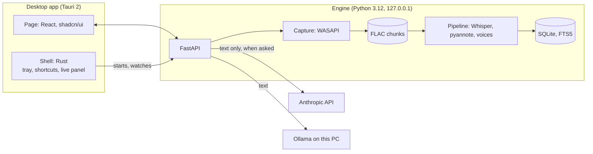

# How ZachCap works

Why it is built the way it is, and what was measured on the way.

## The shape of the problem

- **A call has two real channels:** your microphone, and everything the computer plays. Call apps mix every remote voice into one stream, so who is who has to be rebuilt by diarization (working out who spoke when) and voice matching.
- **No bot, calendar or admin approval.** Everything is captured on your own PC through Windows' audio interfaces.
- **Everyone is identified by voice, including you.** With a headset the mic is only you. With loudspeakers it also hears the call. In a meeting room it holds several people. One approach covers all three.
- **Audio stays local.** Transcription and voices run on the PC. Claude, if you use it, gets text.

## The parts

| Part | Choice | Why |
|---|---|---|
| Shell | Tauri 2 | Light next to a call app; tray, global shortcuts, single instance |
| Page | React, TypeScript, Tailwind, shadcn/ui | - |
| Engine | Python 3.12 with uv, FastAPI | The best speech libraries are Python |
| Speech to text | faster-whisper `large-v3-turbo` | Accurate, and fits a 4 GB GPU |
| Speakers | pyannote `speaker-diarization-community-1` | Also gives an embedding per speaker |
| Storage | SQLite (WAL, FTS5) and FLAC files | One searchable file, nothing to run |
| Secrets | Windows Credential Manager | No keys in files |

PyTorch comes from a CUDA 12.x build because faster-whisper's CTranslate2 loads the cuBLAS and cuDNN libraries inside it. Speech models are pinned to commits (`models.py`).

## From a call to a transcript

1. **Capture.** The mic, and every active output device mixed on one timeline by packet time, so a headset that isn't the Windows default is heard. Each track is written as 5-minute FLAC chunks, so a crash costs little, and what was cut off is recovered at the next start.
2. **Transcribe** each track with Whisper, with word times.
3. **Diarize** each track: speaker turns and one voice embedding per speaker.
4. **Join** words to speakers, and drop mic lines that echo the call.
5. **Match voices.** A speaker's score for a person is the mean of its three best cosine similarities to that person's saved samples: 0.75 and up is named, 0.60 and up is suggested, and anything else is asked about.
6. **Leave out brief voices.** One nobody is known to be, under a share of the talk, isn't listed (`brief.py`). Its words stay.
7. **Store and index**, then summaries and documents when asked.

Models load one at a time and are freed before the next, which is what makes a 4 GB GPU enough.

**Live panel:** a rough transcript while recording, in a process of its own, so a GPU driver crash can't end a recording. It is kept in memory only. The real transcript is made after the call.

## Data

Everything is in `%LOCALAPPDATA%\ZachCap` (`ZACHCAP_HOME` overrides it): `zachcap.db`, and a folder per recording. The schema is at the top of `engine/src/zachcap/store.py`. The main tables are `meetings`, `segments` (who said what, full-text indexed), `meeting_speakers`, `people`, `voice_samples`, `summaries`, `action_items` and `meeting_notes`.

A voice sample is an embedding, not audio. Correcting a name moves it to the right person, and deleting a meeting removes what was learned from it. Ids are never reused, so an old citation can't point at another meeting.

## Security

| Risk | What is done |
|---|---|
| Another program or web page talking to the engine | 127.0.0.1 only, a port Windows picks, a new random token each start; host, token and body size are checked before a request is read (`gate.py`) |
| A crafted recording | Decoded in a child process under a Job Object, with a format list, a time limit and caps of 12 hours and 8 GB |
| Words on a call that try to instruct a model | Other people's text goes to Claude and MCP clients in blocks marked as data; the tools are read-only |
| Words on a call that run in a notes app | Exports escape HTML, images, code fences, Templater and Dataview |
| Paths | Plain drive-letter paths only; network and device paths are refused |
| What the page can open | No opener plugin: fixed commands for the data folder and the releases page |
| The installer fetching code | It carries a wheel built at release time; setup installs locked, hash-checked files only |

Not covered: files aren't encrypted beyond what Windows provides (use BitLocker), and the installer isn't signed.

## Measured

On a laptop with an RTX A500 (4 GB), November 2026:

| What | Result |
|---|---|
| Whisper large-v3-turbo, batched by 8 | 29.7x real time (2.0 min per meeting hour), 2.3 GB |
| A real 37-minute call with 6 speakers | 96 s to transcribe, 257 s to separate speakers |
| Voices on that call, one half against the other | Same person 0.88-0.96, different people 0.07-0.52, which is where the thresholds come from |
| Speaker separation | pyannote's smaller last batch made cuDNN pick a workspace of about 10 GB, which spilled out of a 4 GB GPU. Padding every batch to one size made it about 7x faster with the same result |
| Windows text-to-speech voices | No good for testing voice matching: two different ones score 0.93 alike |
| pyannote telemetry | On by default; ZachCap turns it off |
| Capturing one app (WASAPI process loopback) | Silence for the Teams desktop app ([reported](https://github.com/microsoft/Windows-classic-samples/issues/414)), so every output device is captured instead |

On a 6-core laptop CPU without an NVIDIA GPU:

| What | Result |
|---|---|
| Transcribing | About 21 minutes per meeting hour on every core |
| Faster speaker separation | 194 s to 135 s for a 2.4-minute meeting, the same speakers found |
| `qwen3.5:4b` through Ollama | All 13 promises of a ten-minute call listed, in about four minutes. It did best of the small models tried, and misreads more than Claude |
| Leaving out brief voices in a library of 1,000 meetings | 2 s the first time |

## Building a release

`apps/desktop/scripts/build-installer.ps1`, from a clean checkout of the tag. It builds the engine's wheel with pinned tools, stages a pinned uv and prints the installer's SHA-256. The installer's pages are in `apps/desktop/src-tauri/windows`: Tauri's NSIS template with ZachCap's own pages. Another Tauri CLI version than it was made from is refused, and the template's header says how to bring it up to date.
