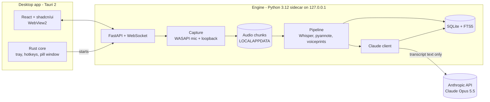

# ZachCap: local meeting recorder that knows who's talking

Status: v0.1 built and tested (see section 11) | started 2026-11-22 | Repo: `ZachGSnow/zachcap` (MIT)

## 1. Goals and non-goals

**Goals**
- Record any call on this PC (Teams, a softphone, anything that plays through the speakers) with **no meeting bot, no calendar, no M365 app registration**.
- Transcribe **on the laptop's own GPU** with Whisper.
- Split the audio into speakers. Name each person once, and **voiceprints stored on the laptop** recognize them in later meetings.
- Summaries, decisions and action items with real names, from **Claude** (Opus 5.5 by default) with your own API key. Only text is sent, never audio.
- A searchable history of every meeting.
- A modern shadcn/Tailscale-style UI.

**Non-goals (v1):** cloud sync, accounts, multiple users, calendar or Graph integration (ever), dictation, live transcription, macOS or Linux.

## 2. Decisions (2026-11-22)

| Topic | Decision |
|---|---|
| Name / repo | ZachCap, `ZachGSnow/zachcap` |
| License | Public, MIT |
| Desktop shell | Tauri 2 (Rust + Visual Studio Build Tools installed) |
| Call setups to support | Headset, laptop or external speakers, and in-room meetings with other people |
| Apps | Teams, plus softphones and anything else that plays through the speakers |
| Transcription timing | After the meeting (no live transcript in v1) |

## 3. Facts that shape the design

- **Test laptop:** Intel Core i7-1360P, 16 GB RAM, NVIDIA RTX A500 Laptop GPU with 4 GB (CUDA compute 8.6), Windows 11.
- **Teams mixes all remote voices into one stream.** That leaves two real channels: the mic and the computer audio. Separate "channels" per person have to be rebuilt by diarization (working out who spoke when).
- **Claude only reads text,** so transcription has to happen locally.
- **Everyone is identified by voiceprint, including you.** That one approach covers all three call setups:
  - **Headset:** the mic track is only you.
  - **Speakers:** the mic can hear remote voices. This laptop's audio chip appears to cancel that echo (see section 9), and text de-duplication is the safety net.
  - **In a room:** the mic track has several people, so it gets diarized too. Your own voiceprint picks out "You".

## 4. Architecture



| Layer | Choice | Why | Alternative |
|---|---|---|---|
| Desktop shell | **Tauri 2** | Small and light on RAM next to Teams. Has plugins for tray, global hotkey, autostart, updater and single-instance, plus Mica on Windows 11. | Electron: same UI, heavier |
| UI | React + TypeScript + Vite + Tailwind v4 + **shadcn/ui**, lucide, cmdk, sonner, wavesurfer.js | The look you want | none |
| Engine | **Python 3.12** (uv), FastAPI | The best speech libraries are Python | Rust + ONNX (sherpa-onnx, whisper.cpp) for a small installer later |
| Capture | **PyAudioWPatch** (WASAPI mic + loopback). In v0.3, Rust process loopback to capture only the meeting app. | Proven in Phase 0 on this laptop | Virtual audio cable: rejected because of echo and drivers |
| Speech-to-text | **faster-whisper `large-v3-turbo`** (int8_float16, silence detection, word timestamps) | Fits in 4 GB and is accurate | NVIDIA Parakeet TDT 0.6B later |
| Diarization | **pyannote `speaker-diarization-community-1`** | Best open model; also returns per-speaker embeddings | sherpa-onnx |
| Voiceprints | Same embedding model, cosine matching, stores both the vector and a short clip | See section 4.3 | none |
| AI | **Claude Opus 5.5** for summaries by default; Sonnet 5.5 or Fable 5.1 selectable | Caught more implicit commitments in testing | Haiku 5.5 for titles and tags later |
| Storage | SQLite (WAL) + FTS5; FLAC while working, Opus to archive | One file, searchable | none |
| Secrets | Windows Credential Manager (`keyring`), with environment variables as a fallback | No plaintext keys | none |

`torch` is pinned to a CUDA 12.x wheel (cu128) because faster-whisper's CTranslate2 loads the cuBLAS 12 and cuDNN 9 DLLs that ship inside it.

### 4.1 Processing pipeline (runs when you press Stop)

1. Finish the recording chunks into `mic.flac` and `system.flac`, plus 16 kHz mono working copies.
2. Transcribe both tracks with Whisper (silence detection, word timestamps).
3. Diarize both tracks: the computer-audio track always, and the mic track when it holds more than one voice.
4. Assign each word to a speaker; flag overlapping speech.
5. Compute an embedding for each speaker, match it against the voiceprint library (you included), and auto-label, suggest a name, or mark it Unknown.
6. Merge both tracks into one timeline. Drop mic lines that duplicate the computer audio (echo).
7. Send the transcript to Claude and get back structured JSON: summary, decisions, action items (owner and due date), open questions, topics with timestamps.
8. Index it for search, then notify: "Ready: 2 speakers need names."

### 4.2 Data model (SQLite)

- `meetings`: id, title, source_app, started_at, ended_at, status, audio paths, notes
- `segments`: id, meeting_id, track, start, end, text, meeting_speaker_id, confidence (FTS5 index on text)
- `meeting_speakers`: id, meeting_id, track, label, person_id, match_score, centroid embedding, status
- `people`: id, name, org, color, notes, is_me
- `voice_samples`: id, person_id, meeting_id, start, end, clip_path, embedding, model_id, quality
- `summaries`: meeting_id, template, model, json, tokens, cost
- `action_items`: id, meeting_id, owner person_id, text, due, status
- `bookmarks`: meeting_id, t, note

Data folder: `%LOCALAPPDATA%\ZachCap\`, outside OneDrive.

### 4.3 Voiceprints: how it learns

- **Your voice first:** first-run onboarding records about 20 seconds of you reading a paragraph. That gives the "You" voiceprint.
- **Matching:** each meeting speaker's average embedding is compared with each person's saved samples (mean of the top 3 cosine similarities). Each person can match only one speaker per meeting. Two strong matches to the same person become a "merge?" suggestion.
- **Thresholds:** above a high threshold, auto-label and show the confidence. Between the high and low thresholds, suggest the name. Below the low threshold, mark it Unknown. Tune them from your corrections.
- **Learning:** each confirmation saves 2-5 clean segments (2 seconds or longer, no overlapping speech). Keep about 30 varied samples per person and drop the worst. "Not this person" is stored as a negative.
- **Backfill:** naming someone can label them in older meetings too, because per-meeting speaker embeddings are kept.
- **Model changes:** clips are kept, so voiceprints can be recomputed if the embedding model changes.
- **Deleting a person** removes their clips, vectors and samples.
- **Expectations:** regular colleagues should be recognized after 2-3 tagged meetings. Recognition is weaker for dial-ins, cross-talk and shared room mics.

### 4.4 Engineering gotchas

- **Silent loopback:** WASAPI loopback can stop delivering data when nothing is playing. On this laptop it didn't (see section 9), but a silent keepalive output stream costs nothing, so it stays.
- **Clock drift:** the mic and output devices drift apart. Timestamp every buffer and align when merging.
- **Echo on speakers:** handled by the audio chip on this laptop, with text de-duplication as a fallback. Software echo cancellation only if it's ever needed.
- **Device changes mid-meeting** (headset plugged in): reopen the streams without losing the recording.
- **Crash safety:** record in 1-5 minute chunks and recover on the next launch.
- **4 GB of GPU memory:** run the models one at a time, unload between stages, CPU fallback.
- **Local API security:** bind to 127.0.0.1 on a random port, require a per-launch token, and check Host/Origin headers.
- **The mic is a 4-channel array with identical channels** (already processed by the audio chip): downmix to mono.

## 5. Features

Legend: **MVP** = day 1 | **0.2** = next 1-2 weeks | **0.3** = after that | **Later**

### Recording
- **MVP:** Start/stop in the app; mic picker (defaults to the Windows default communications device); loopback of the default output; crash-safe two-track recording.
- **0.2:** Tray icon with a native menu like Tailscale's; global hotkey (`Ctrl+Alt+R`); floating **recording pill** that's always on top (timer, You/Meeting level meters, bookmark, stop); start with Windows.
- **0.2:** Notes pad and bookmarks during the meeting, which feed the summary.
- **0.2:** Consent helper: copy "I'm recording this for notes" for the chat, or a one-line script to say on a phone call.
- **0.2:** Meeting title from the Teams window title, with an AI title as fallback.
- **0.2:** Import a recording (mp3/mp4/wav).
- **0.3:** Call detection: watch Windows' microphone-in-use status (Teams, softphones), then show a "Call started, record?" toast. It never records silently by default.
- **0.3:** Capture one app only (process loopback): pick Teams or the softphone, and Spotify and notification sounds are left out.

### Transcript and speakers
- **MVP:** Transcript with names, colors and timestamps; click any line to play from there.
- **MVP:** **"Who's this?"** cards for unknown speakers: a 5-second sample, suggested names, or type a new name. Saving creates the voiceprint.
- **MVP:** Known voices (you included) are labeled automatically; in-room voices are diarized from the mic track.
- **0.2:** Merge speakers, reassign a single line, split a speaker, edit text inline.
- **0.2:** **Speaker lanes** (a timeline of who spoke when) with **solo** to play only one person.
- **0.2:** Talk-time stats; backfill names into older meetings; People page.

### AI (Claude)
- **MVP:** Summary: overview, decisions, action items (owner and due date), open questions.
- **0.2:** Templates (client call, 1:1, standup, internal) and custom instructions.
- **0.2:** **Ask this meeting** (prompt-cached).
- **0.3:** **Ask across meetings**; action-item tracker across meetings.
- **Cost display:** per-call estimate and a monthly total (about $0.05 per one-hour summary).

### History and search
- **MVP:** Meeting list grouped by Today / This week / Earlier, with status chips (Recording, Processing, Needs names, Ready).
- **0.2:** Full-text search with filters for person, date and tag; `Ctrl+K` palette; export to Markdown, DOCX, JSON or SRT/VTT.

### Privacy and settings
- **MVP:** API keys in Windows Credential Manager.
- **0.2:** Retention (delete audio after N days, keep text); deleting a meeting removes everything; a "local only" switch.
- **Later:** Encrypt the database at rest; signed installer and auto-updates.

## 6. Appearance

The shadcn/Tailscale look carries over. Tauri draws the UI with WebView2 (the Edge engine built into Windows 11), so shadcn components look exactly as they do on the web. Native touches (tray, Mica, custom title bar) make it feel like a Windows app. The app lives in the tray like Tailscale, and the window is for reviewing meetings.

- Neutral zinc palette, light/dark following the Windows setting, one accent color.
- Inter for the UI and Geist Mono for timestamps; 13-14 px text; tabular numbers.
- 1 px hairline borders, 8 px radius, shadows only on popovers and dialogs.
- lucide icons, sonner toasts, skeleton loaders. Keyboard-first: `Ctrl+K`, `J`/`K`, `Space`.
- Speaker colors: an accessible 8-color palette, always shown next to the name.
- Custom title bar, with Mica behind the sidebar on Windows 11.

**Screens:** tray menu | recording pill | Meetings | Meeting detail | People | Search | Settings (Audio, Transcription, Speakers, AI, Storage & privacy, Shortcuts, About)

```
+------------------------------------------------------------------------+
| ZachCap                                                       _  []  X |
+---------------+--------------------------------------------------------+
| Meetings      | Weekly sync - Contoso             Fri Nov 21 - 47 min  |
| People        | (DL) (MR) (ZS) +2      Summary  [Transcript]  Speakers |
| Search Ctrl+K | +----------------------------------------------------+ |
|               | | 2 speakers need names                              | |
|               | | > Speaker 3   "...so cutover is Friday night"      | |
|               | |   [Dana Lee 87%]  [Mark Ruiz]  [+ New person]      | |
|               | +----------------------------------------------------+ |
|               | 04:12  o Dana Lee   We moved the firewall rules...     |
|               | 04:31  o You        OK - and the VPN profile?          |
| Settings      | 04:40  o Speaker 3  So cutover is Friday night...      |
|               +--------------------------------------------------------+
|               | > 04:12 / 47:03   ..::||||::..::|||::..::||:.   1.0x   |
|               | Dana       ==    ===        =            [solo]        |
|               | You           ==      ==        ==       [solo]        |
|               | Speaker 3          ====           ==     [solo]        |
+---------------+--------------------------------------------------------+
```

## 7. Repo

- Changes go through short-lived branches and pull requests; `main` stays releasable and CI must pass.
- **Never commit** recordings, transcripts, voiceprints, `.env` or databases. Test audio is synthetic, generated with Windows TTS voices (`engine/scripts/make_meeting.py`).
- CI: GitHub Actions on `windows-latest`: engine tests on CPU, plus UI lint, typecheck and build.

```
zachcap/
  apps/desktop/          Tauri 2 + React + shadcn
  engine/                Python 3.12 package (uv)
    src/zachcap/         capture, asr, diarize, voiceprint, summarize, store, api
    scripts/             Phase 0 probes, TTS fixture generator
    tests/
  docs/
  .github/workflows/
```

## 8. Build plan

### Day 1

| Block | Goal | Done when |
|---|---|---|
| 0. Setup + capture test | Install the tools; record mic + computer audio; time Whisper on the A500 | Two aligned tracks and a minutes-per-hour number |
| 1. Engine pipeline | Whisper + diarization + merge + SQLite; `zachcap process` | Transcript shows You / Speaker 1..n |
| 2. Voiceprints | Enroll you; naming a speaker saves a voiceprint; the next meeting matches automatically | A second meeting auto-labels a person you tagged |
| 3. Desktop UI | Tauri + shadcn: meeting list, meeting view, transcript with playback, "Who's this?" cards, record button | The whole loop works in the app |
| 4. Claude + publish | Summary tab; repo pushed | A summary with real names; the repo on GitHub |

### After day 1

- **0.2:** tray, hotkey, pill, notes, speaker editing, lanes and solo, People page, search and palette, exports, templates, retention, backfill.
- **0.3:** call detection, one-app capture, ask across meetings, action-item tracker.
- **Later:** live transcript, Parakeet option, Rust/ONNX engine, database encryption, signed installer.

**Validation:** use it for 3-4 weeks and track the share of speakers auto-labeled correctly, processing minutes per meeting hour, and corrections per meeting.

## 9. Phase 0 findings (2026-11-22)

| Check | Result |
|---|---|
| Loopback capture on the test laptop | **Works.** Realtek speakers, 48 kHz stereo, 99.9% coverage |
| Loopback gaps during silence | **None on this laptop**, even without the keepalive stream; the keepalive stays as insurance |
| Mic | Intel SST 4-channel array, 48 kHz, identical channels (already processed). Speech at about -39 dBFS average and -19 dBFS peaks |
| Echo from laptop speakers into the mic | **Almost none** (envelope correlation 0.07) with the speakers at 36% volume. The audio chip appears to cancel echo; confirm in a real call |
| Whisper `large-v3-turbo` on the RTX A500, sequential | 18.5x real time on 2.4 min, 9.3x on 29 min (6.5 min per meeting hour); 1.3 GB GPU |
| Whisper `large-v3-turbo`, batched (batch 8) | **29.7x real time: 2.0 min per meeting hour**; 2.3 GB GPU. Now the default |
| Accuracy on synthetic speech | 0% word error rate (clean TTS; real calls will be higher) |
| pyannote 4.1 telemetry | On by default (file durations, speaker counts to `otel.pyannote.ai`). ZachCap sets `PYANNOTE_METRICS_ENABLED=false` |
| Speaker separation speed | pyannote's last embedding batch is smaller than the rest; that new shape made cuDNN pick a convolution needing ~10 GB of workspace, which Windows spilled into shared system memory (one batch took 95 s instead of 1 s). Padding every batch to the same size fixed it: about 7x faster, identical output. Half precision was faster still but broke clustering, so it is not used |
| Synthetic voices for voice recognition | Not usable: the embedding model rates two different Windows TTS voices 0.93 alike, above each voice's similarity to itself. Voice matching is tuned on real recordings only |
| Summary model | Same transcript through Sonnet 5.5, Opus 5.5 and Fable 5.1: all accurate; Opus 5.5 also caught an implicit commitment the others missed. Opus 5.5 is the default (about $0.08 per meeting hour), with Sonnet 5.5 and Fable 5.1 selectable in Settings |
| Real recording, end to end | A 37-minute real Teams recording: 96 s to transcribe, 257 s to separate 6 speakers, 353 s in total (about 9.5 min per meeting hour) |
| Voice recognition on real voices | The recording processed as two halves, first-half speakers named: the returning speaker was recognized automatically at 0.96. Same person 0.88-0.96, different people 0.07-0.52, so the thresholds are 0.75 (auto) and 0.60 (suggest) |
| SQLite across threads | FastAPI opened a request's connection on one worker thread and used it on another; audio playback failed until connections allowed it (regression test added) |

## 10. Risks

| Risk | Mitigation |
|---|---|
| Recording consent and company policy | Consent helper; check policy before real use |
| Voiceprints count as biometric data | Stay on the laptop; delete controls; this is for personal use |
| Windows CUDA setup | Pinned versions; CPU fallback |
| Accuracy for dial-ins and cross-talk | Show confidence; make correcting one click |
| Echo on other hardware | Text de-duplication; software echo cancellation if needed |

## 11. What v0.1 includes (2026-11-22)

Built and tested in the app with synthetic meetings, plus the real recording above:

- Recording: one button, Ctrl+Alt+R from anywhere, tray menu, live level meters, crash-safe chunks,
  device pickers (Windows default, any mic or output, or a virtual cable), call detection from
  Windows' microphone-in-use status with a "Record?" prompt.
- Import: any audio or video file (Teams .mp4, .m4a, .mp3, .wav...) with an optional time range.
- Transcript: speaker names and colors, filter, click a time to play, move one line to another person.
- Speakers: "Who's this?" cards with a sample to play, automatic recognition, talk-time chart, rename.
- Speaker lanes with solo playback: plays only one person, from their own track.
- Summaries (Opus 5.5 by default): overview, decisions, action items as commitments or assignments
  with due dates and "said at" links, who said what, open questions, topics.
- Action item tracker across meetings (open/done, mine, commitments vs assigned).
- Ask a meeting: answers from the transcript with clickable timestamps.
- History with stats, full-text search, people with talk time and voice samples.
- Settings: your name, devices, language, Claude model, API keys, data folder.

## 12. Added after v0.1 (2026-11-23)

Each change went through its own pull request with green CI, after two rounds of code review
(engine, UI, shell and CI) and competitor research.

| Area | What | How it was checked |
|---|---|---|
| Interruptions | The meeting row exists from the first second; Quit, sign-out and shutdown stop and save the recording; the engine's watchdog saves it if the app dies; startup recovers cut-off recordings and re-queues interrupted processing; an unfinished FLAC chunk is read with FFmpeg | Killing the app mid-recording saved an 8.2 s meeting; hard-killing the engine left `complete: false`, and the next start processed it; a 77 s recording with unclosed chunks transcribed to 76.6 s on the GPU |
| Reprocessing | Results replace the old ones in one transaction, so a failed reprocess keeps the last good transcript | Unit tests; failure paths keep names and lines |
| Data integrity | Correcting a name moves the voiceprint; Regenerate keeps done marks; no empty voiceprints; lines move to unnamed voices by id; atomic playback cache | Unit tests |
| UI robustness | Interrupted jobs can be run again; failures are reported; notifications while in the tray; Space, seek and speed fixes; error boundary | Browser and desktop checks |
| Performance | Memoized transcript rows, one shared menu, memoized lane bars | A 2,000-line meeting: worst UI stall during playback went from 2.7 s to 83 ms |
| Shell | Single instance, Start with Windows (release builds), tray hint, red recording dot, engine restart banner, CSP, no opener plugin, `open_data_folder` takes no path | Release build checks |
| Ask across meetings | Claude searches the library with read-only tools and cites `[M12 04:31]`; Brief me on a person; after 10 rounds of lookups it answers from what it found, with tools off; tools say when they leave results out, and long transcripts come in parts | Real questions on the demo library: $0.02-0.05 each, every fact cited; the out-of-lookups turn checked against the API on synthetic meetings |
| Words to know | Hotwords for Whisper (as a sentence), corrections in one pass (terms are text, so `CORP\admin` is safe), spellings for Claude; capitalization is fixed only for terms that can't be ordinary words (ConnectWise, M365, not Will or IT) | A bare comma list made Whisper drop every full stop (6 to 0); a sentence kept all 6. The longest list Settings takes, on 1,000 lines: 18 s before, 0.06 s now |
| Kinds of meeting and recipes | Seven summary focuses; follow-up email, status update, ticket notes | A real follow-up email for $0.026 |
| Notes, bookmarks, pause | Recording bar notes, Ctrl+Alt+B bookmarks, private pause that writes silence | A real 7 s recording: notes at 1.9 s and 3.1 s, tracks stayed in sync through the pause |
| Exports | Markdown, text, SRT; export folder kept up to date, one file per meeting named with its id (M12), rewritten after any edit | Downloads and the folder backfill on the demo library; unit tests for renames and same-minute titles |
| MCP server | `zachcap mcp`, five read-only tools, database opened read-only | A real stdio client listed the tools and searched |
| Conversation stats | Pace, longest stretch, questions, talked over | Unit tests; demo meeting |
| Privacy | Keep recordings for N days; mask contact details for Claude; heads-up text | Unit tests (retention touches only finished meetings in ZachCap's folder) |
| Home page | Two weeks of meeting time; your open items | Browser check |
| Every speaker and headset | The computer's audio from every active output at once, through Core Audio (live device list), mixed on one timeline by packet times; outputs plugged in mid-call join, unplugged ones drop out; 24-bit; playback evens out a quiet call against the mic | A 6.3 s recording on the test laptop: the track kept real time, a sound played at 2.3 s landed at 2.3 s, both tracks loaded at the same length; joining, unplugging, retries, pause and resampling are unit-tested with a fake Core Audio |
| Capture health and smart stop | A watch on each recording: no signal at all from the mic for a minute (muted), no call audio two minutes into a call, under 500 MB free; Windows kept awake while recording; when the call app lets go of the mic and it goes quiet for 10 s, a 15 s countdown to stop (60 s after ten quiet minutes in a room), cancelled by Keep recording or by anyone speaking | Unit tests with a fake clock, calls and disk; in the browser with a stubbed engine: the warning toast, both countdowns, Keep recording, cancel by speech, and the stop when it runs out; on the test laptop the system's "system required" state was set only while recording |
| Work log | A day's or a week's meetings with people, overview, decisions and action items, and a draft time entry per meeting rounded up to 15 minutes; built locally from the summaries; a Work log page, a daily and weekly file in the export folder (optional), and a read-only tool for Ask and MCP that cites [M12]; deleting a meeting now removes its export file too | Unit and API tests; the demo library's week in the browser (stats, time entries, both meetings, ticking an item off and back) |
| Snapshots of the call | Ctrl+Alt+S, the tray or the recording bar's camera: the call window (or the window behind ZachCap) drawn by itself with PrintWindow, so a covered window or a dark screen still comes out; Windows' own text recognition (Windows.Media.Ocr) reads it; the picture stays in the meeting folder and the text becomes a note for summaries and Ask | A synthetic window read back word for word in 0.18 s with the display off (the screen capture was all black, which is why PrintWindow is used); the demo meeting showed the marker, the note with its picture and the full view; API tests with a stand-in capture |

The cost shown next to each answer prices every attempt at the rates of the model that ran it (a fallback included), cache reads at that model's own rate.

Tests: 32 at v0.1, 154 now. CI no longer installs the GPU stack and checks `uv.lock`.

## 13. Next, from competitor research (2026-11-23)

Surveyed the current feature pages and changelogs of Granola, Otter, Fireflies, Fathom, tl;dv,
Krisp, Jamie, Read.ai, Bluedot, Tactiq, Notion AI meeting notes, Teams Premium, Zoom AI
Companion, Meetily, anarlog (formerly Hyprnote/Char), Screenpipe, MacWhisper, Superwhisper,
Wispr Flow and the Recall.ai desktop SDK. ZachCap already matches them on summaries, action
items, asking across meetings and MCP; the gaps are in capture reliability, help during the
call, and output workflows. Ruled out by the constraints: calendar-driven features, bots,
virtual audio or camera drivers, mobile apps.

**Measured before planning: one-app capture can't record Teams.** WASAPI process loopback
(`AUDIOCLIENT_ACTIVATION_TYPE_PROCESS_LOOPBACK`) works from Python through comtypes on the test
laptop: it streams continuously (4.00 s of audio in 4.00 s) and isolates one process (the
target at RMS 0.044, a second process at 0.000). But it returns silence for the Teams desktop
app, an open issue in Microsoft's own sample
([Windows-classic-samples#414](https://github.com/microsoft/Windows-classic-samples/issues/414)),
where communications-category audio was reproduced as silent on build 26200. So the roadmap's
"one-app capture" is dropped in favor of capturing every output device.

Build order (each its own pull request, then a review round):

| # | Feature | Why | Who has it | Size |
|---|---|---|---|---|
| 1 | **Every speaker and headset**: loopback from all active output devices, mixed on one timeline by packet timestamps; devices plugged in mid-call join, unplugged ones drop out; 24-bit so quiet calls keep detail | Recording only the default output loses the far side when Teams plays on a headset that isn't the Windows default, or when the device changes mid-call | Wispr records every active output; Granola's Windows docs list calls lost this way | L |
| 2 | **Capture health**: warn when call audio is silent while a call app holds the mic, or the mic is flat; keep the PC awake while recording; warn on low disk | A silent track loses the meeting, and today nothing says so | Wispr, Granola, Recall SDK | M |
| 3 | **Smart stop**: when the call app releases the mic and both tracks go quiet, a countdown to stop (Keep recording cancels); a check-in after long silence for in-room meetings | Forgotten recordings run on and merge calls | Granola, Jamie, Notion, Wispr | M |
| 4 | **Your own templates and prompts**: edit the kinds of meeting and the one-click documents, or add new ones (a client's ticket format) | Each client or ticket system wants its own format | Granola recipes, Notion, Zoom, Fathom, Tactiq | M |
| 5 | **Redact a moment**: silence a stretch of both tracks and remove its lines (a password or MFA code read aloud) | IT calls carry secrets; masking covers only emails, phones and cards | Granola | M |
| 6 | **Fix a line's words**, offering to add the fix to Words to know | Misheard names and terms stay wrong in search and summaries | Otter, MacWhisper | M |
| 7 | **Daily and weekly digest**: a work log of calls with people, action items and draft time-entry lines, saved to the export folder and readable over MCP | Time entries and standups | tl;dv, Granola, Teams recap | M |
| 8 | **Where your name was said**: markers on the timeline | Jump to where you were asked something | Teams Premium | S |
| 9 | **Watch-folder import**: recordings dropped in a folder (softphone or phone-system exports) import themselves | No manual import for recorded calls | MacWhisper | S |

Later: push-to-talk dictation with a "ticket note" mode (Fireflies Talk, Superwhisper, Wispr), client tags, topic trackers, live
transcript and "catch me up", a Teams accessibility bridge for mute state and names (fragile),
signed installer.
