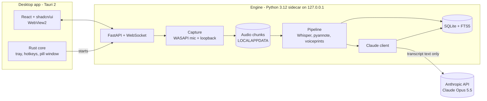

# ZachCap: local meeting recorder that knows who's talking

Status: v0.2.0 released (section 16); main has more since (section 17) | started 2026-11-22 | Repo: `ZachGSnow/zachcap` (MIT)

## 1. Goals and non-goals

**Goals**
- Record any call on this PC (Teams, a softphone, anything that plays through the speakers) with **no meeting bot, no calendar, no M365 app registration**.
- Transcribe **on the laptop's own GPU** with Whisper.
- Split the audio into speakers. Name each person once, and **voiceprints stored on the laptop** recognize them in later meetings.
- Summaries, decisions and action items with real names, from **Claude** (Opus 5.5 by default) with your own API key. Only text is sent, never audio.
- A searchable history of every meeting.
- A modern shadcn/Tailscale-style UI.

**Non-goals (v1):** cloud sync, accounts, multiple users, calendar or Graph integration (ever), live transcription, macOS or Linux.

## 2. Decisions (2026-11-22)

| Topic | Decision |
|---|---|
| Name / repo | ZachCap, `ZachGSnow/zachcap` |
| License | Public, MIT |
| Desktop shell | Tauri 2 (Rust + Visual Studio Build Tools installed) |
| Call setups to support | Headset, laptop or external speakers, and in-room meetings with other people |
| Apps | Teams, plus softphones and anything else that plays through the speakers |
| Transcription timing | After the meeting (no live transcript in v1) |

## 3. Facts that shape the design

- **Test laptop:** Intel Core i7-1360P, 16 GB RAM, NVIDIA RTX A500 Laptop GPU with 4 GB (CUDA compute 8.6), Windows 11.
- **Second PC (from 2026-11-24):** AMD Ryzen AI 5 340 (6 cores, 12 threads), 15 GB RAM, Radeon 840M and no NVIDIA GPU, so everything runs on the CPU there (times in section 16).
- **Teams mixes all remote voices into one stream.** That leaves two real channels: the mic and the computer audio. Separate "channels" per person have to be rebuilt by diarization (working out who spoke when).
- **Claude only reads text,** so transcription has to happen locally.
- **Everyone is identified by voiceprint, including you.** That one approach covers all three call setups:
  - **Headset:** the mic track is only you.
  - **Speakers:** the mic can hear remote voices. This laptop's audio chip appears to cancel that echo (see section 9), and text de-duplication is the safety net.
  - **In a room:** the mic track has several people, so it gets diarized too. Your own voiceprint picks out "You".

## 4. Architecture



| Layer | Choice | Why | Alternative |
|---|---|---|---|
| Desktop shell | **Tauri 2** | Small and light on RAM next to Teams. Has plugins for tray, global hotkey, autostart, updater and single-instance, plus Mica on Windows 11. | Electron: same UI, heavier |
| UI | React + TypeScript + Vite + Tailwind v4 + **shadcn/ui**, lucide, cmdk, sonner, wavesurfer.js | The look you want | none |
| Engine | **Python 3.12** (uv), FastAPI | The best speech libraries are Python | Rust + ONNX (sherpa-onnx, whisper.cpp) for a small installer later |
| Capture | **PyAudioWPatch** (WASAPI mic + loopback). In v0.3, Rust process loopback to capture only the meeting app. | Proven in Phase 0 on this laptop | Virtual audio cable: rejected because of echo and drivers |
| Speech-to-text | **faster-whisper `large-v3-turbo`** (int8_float16, silence detection, word timestamps) | Fits in 4 GB and is accurate | NVIDIA Parakeet TDT 0.6B later |
| Diarization | **pyannote `speaker-diarization-community-1`** | Best open model; also returns per-speaker embeddings | sherpa-onnx |
| Voiceprints | Same embedding model, cosine matching, stores both the vector and a short clip | See section 4.3 | none |
| AI | **Claude Opus 5.5** for summaries by default; Sonnet 5.5 or Fable 5.1 selectable | Caught more implicit commitments in testing | Haiku 5.5 for titles and tags later |
| Storage | SQLite (WAL) + FTS5; FLAC while working, Opus to archive | One file, searchable | none |
| Secrets | Windows Credential Manager (`keyring`), with environment variables as a fallback | No plaintext keys | none |

`torch` is pinned to a CUDA 12.x wheel (cu128) because faster-whisper's CTranslate2 loads the cuBLAS 12 and cuDNN 9 DLLs that ship inside it.

### 4.1 Processing pipeline (runs when you press Stop)

1. Finish the recording chunks into `mic.flac` and `system.flac`, plus 16 kHz mono working copies.
2. Transcribe both tracks with Whisper (silence detection, word timestamps).
3. Diarize both tracks: the computer-audio track always, and the mic track when it holds more than one voice.
4. Assign each word to a speaker; flag overlapping speech.
5. Compute an embedding for each speaker, match it against the voiceprint library (you included), and auto-label, suggest a name, or mark it Unknown.
6. Merge both tracks into one timeline. Drop mic lines that duplicate the computer audio (echo).
7. Send the transcript to Claude and get back structured JSON: summary, decisions, action items (owner and due date), open questions, topics with timestamps.
8. Index it for search, then notify: "Ready: 2 speakers need names."

### 4.2 Data model (SQLite)

- `meetings`: id, title, source_app, started_at, ended_at, status, audio paths, notes
- `segments`: id, meeting_id, track, start, end, text, meeting_speaker_id, confidence (FTS5 index on text)
- `meeting_speakers`: id, meeting_id, track, label, person_id, match_score, centroid embedding, status
- `people`: id, name, org, color, notes, is_me
- `voice_samples`: id, person_id, meeting_id, start, end, clip_path, embedding, model_id, quality
- `summaries`: meeting_id, template, model, json, tokens, cost
- `action_items`: id, meeting_id, owner person_id, text, due, status
- `bookmarks`: meeting_id, t, note

Data folder: `%LOCALAPPDATA%\ZachCap\`, outside OneDrive.

### 4.3 Voiceprints: how it learns

- **Your voice first:** first-run onboarding records about 20 seconds of you reading a paragraph. That gives the "You" voiceprint.
- **Matching:** each meeting speaker's average embedding is compared with each person's saved samples (mean of the top 3 cosine similarities). Each person can match only one speaker per meeting. Two strong matches to the same person become a "merge?" suggestion.
- **Thresholds:** above a high threshold, auto-label and show the confidence. Between the high and low thresholds, suggest the name. Below the low threshold, mark it Unknown. Tune them from your corrections.
- **Learning:** each confirmation saves 2-5 clean segments (2 seconds or longer, no overlapping speech). Keep about 30 varied samples per person and drop the worst. "Not this person" is stored as a negative.
- **Backfill:** naming someone can label them in older meetings too, because per-meeting speaker embeddings are kept.
- **Model changes:** clips are kept, so voiceprints can be recomputed if the embedding model changes.
- **Deleting a person** removes their clips, vectors and samples.
- **Expectations:** regular colleagues should be recognized after 2-3 tagged meetings. Recognition is weaker for dial-ins, cross-talk and shared room mics.

### 4.4 Engineering gotchas

- **Silent loopback:** WASAPI loopback can stop delivering data when nothing is playing. On this laptop it didn't (see section 9), but a silent keepalive output stream costs nothing, so it stays.
- **Clock drift:** the mic and output devices drift apart. Timestamp every buffer and align when merging.
- **Echo on speakers:** handled by the audio chip on this laptop, with text de-duplication as a fallback. Software echo cancellation only if it's ever needed.
- **Device changes mid-meeting** (headset plugged in): reopen the streams without losing the recording.
- **Crash safety:** record in 1-5 minute chunks and recover on the next launch.
- **4 GB of GPU memory:** run the models one at a time, unload between stages, CPU fallback.
- **Local API security:** bind to 127.0.0.1 on a random port, require a per-launch token, and check Host/Origin headers.
- **The mic is a 4-channel array with identical channels** (already processed by the audio chip): downmix to mono.

## 5. Features

Legend: **MVP** = day 1 | **0.2** = next 1-2 weeks | **0.3** = after that | **Later**

### Recording
- **MVP:** Start/stop in the app; mic picker (defaults to the Windows default communications device); loopback of the default output; crash-safe two-track recording.
- **0.2:** Tray icon with a native menu like Tailscale's; global hotkey (`Ctrl+Alt+R`); floating **recording pill** that's always on top (timer, You/Meeting level meters, bookmark, stop); start with Windows.
- **0.2:** Notes pad and bookmarks during the meeting, which feed the summary.
- **0.2:** Consent helper: copy "I'm recording this for notes" for the chat, or a one-line script to say on a phone call.
- **0.2:** Meeting title from the Teams window title, with an AI title as fallback.
- **0.2:** Import a recording (mp3/mp4/wav).
- **0.3:** Call detection: watch Windows' microphone-in-use status (Teams, softphones), then show a "Call started, record?" toast. It never records silently by default.
- **0.3:** Capture one app only (process loopback): pick Teams or the softphone, and Spotify and notification sounds are left out.

### Transcript and speakers
- **MVP:** Transcript with names, colors and timestamps; click any line to play from there.
- **MVP:** **"Who's this?"** cards for unknown speakers: a 5-second sample, suggested names, or type a new name. Saving creates the voiceprint.
- **MVP:** Known voices (you included) are labeled automatically; in-room voices are diarized from the mic track.
- **0.2:** Merge speakers, reassign a single line, split a speaker, edit text inline.
- **0.2:** **Speaker lanes** (a timeline of who spoke when) with **solo** to play only one person.
- **0.2:** Talk-time stats; backfill names into older meetings; People page.

### AI (Claude)
- **MVP:** Summary: overview, decisions, action items (owner and due date), open questions.
- **0.2:** Templates (client call, 1:1, standup, internal) and custom instructions.
- **0.2:** **Ask this meeting** (prompt-cached).
- **0.3:** **Ask across meetings**; action-item tracker across meetings.
- **Cost display:** per-call estimate and a monthly total (about $0.05 per one-hour summary).

### History and search
- **MVP:** Meeting list grouped by Today / This week / Earlier, with status chips (Recording, Processing, Needs names, Ready).
- **0.2:** Full-text search with filters for person, date and tag; `Ctrl+K` palette; export to Markdown, DOCX, JSON or SRT/VTT.

### Privacy and settings
- **MVP:** API keys in Windows Credential Manager.
- **0.2:** Retention (delete audio after N days, keep text); deleting a meeting removes everything; a "local only" switch.
- **Later:** Encrypt the database at rest; signed installer and auto-updates.

## 6. Appearance

The shadcn/Tailscale look carries over. Tauri draws the UI with WebView2 (the Edge engine built into Windows 11), so shadcn components look exactly as they do on the web. Native touches (tray, Mica, custom title bar) make it feel like a Windows app. The app lives in the tray like Tailscale, and the window is for reviewing meetings.

- Neutral zinc palette, light/dark following the Windows setting, one accent color.
- Inter for the UI and Geist Mono for timestamps; 13-14 px text; tabular numbers.
- 1 px hairline borders, 8 px radius, shadows only on popovers and dialogs.
- lucide icons, sonner toasts, skeleton loaders. Keyboard-first: `Ctrl+K`, `J`/`K`, `Space`.
- Speaker colors: an accessible 8-color palette, always shown next to the name.
- Custom title bar, with Mica behind the sidebar on Windows 11.

**Screens:** tray menu | recording pill | Meetings | Meeting detail | People | Search | Settings (Audio, Transcription, Speakers, AI, Storage & privacy, Shortcuts, About)

```
+------------------------------------------------------------------------+
| ZachCap                                                       _  []  X |
+---------------+--------------------------------------------------------+
| Meetings      | Weekly sync - Contoso             Fri Nov 21 - 47 min  |
| People        | (DL) (MR) (ZS) +2      Summary  [Transcript]  Speakers |
| Search Ctrl+K | +----------------------------------------------------+ |
|               | | 2 speakers need names                              | |
|               | | > Speaker 3   "...so cutover is Friday night"      | |
|               | |   [Dana Lee 87%]  [Mark Ruiz]  [+ New person]      | |
|               | +----------------------------------------------------+ |
|               | 04:12  o Dana Lee   We moved the firewall rules...     |
|               | 04:31  o You        OK - and the VPN profile?          |
| Settings      | 04:40  o Speaker 3  So cutover is Friday night...      |
|               +--------------------------------------------------------+
|               | > 04:12 / 47:03   ..::||||::..::|||::..::||:.   1.0x   |
|               | Dana       ==    ===        =            [solo]        |
|               | You           ==      ==        ==       [solo]        |
|               | Speaker 3          ====           ==     [solo]        |
+---------------+--------------------------------------------------------+
```

## 7. Repo

- Changes go through short-lived branches and pull requests; `main` stays releasable and CI must pass.
- **Never commit** recordings, transcripts, voiceprints, `.env` or databases. Test audio is synthetic, generated with Windows TTS voices (`engine/scripts/make_meeting.py`).
- CI: GitHub Actions on `windows-latest`: engine tests on CPU, plus UI lint, typecheck and build.

```
zachcap/
  apps/desktop/          Tauri 2 + React + shadcn
  engine/                Python 3.12 package (uv)
    src/zachcap/         capture, asr, diarize, voiceprint, summarize, store, api
    scripts/             Phase 0 probes, TTS fixture generator
    tests/
  docs/
  .github/workflows/
```

## 8. Build plan

### Day 1

| Block | Goal | Done when |
|---|---|---|
| 0. Setup + capture test | Install the tools; record mic + computer audio; time Whisper on the A500 | Two aligned tracks and a minutes-per-hour number |
| 1. Engine pipeline | Whisper + diarization + merge + SQLite; `zachcap process` | Transcript shows You / Speaker 1..n |
| 2. Voiceprints | Enroll you; naming a speaker saves a voiceprint; the next meeting matches automatically | A second meeting auto-labels a person you tagged |
| 3. Desktop UI | Tauri + shadcn: meeting list, meeting view, transcript with playback, "Who's this?" cards, record button | The whole loop works in the app |
| 4. Claude + publish | Summary tab; repo pushed | A summary with real names; the repo on GitHub |

### After day 1

- **0.2:** tray, hotkey, pill, notes, speaker editing, lanes and solo, People page, search and palette, exports, templates, retention, backfill.
- **0.3:** call detection, one-app capture, ask across meetings, action-item tracker.
- **Later:** live transcript, Parakeet option, Rust/ONNX engine, database encryption, signed installer.

**Validation:** use it for 3-4 weeks and track the share of speakers auto-labeled correctly, processing minutes per meeting hour, and corrections per meeting.

## 9. Phase 0 findings (2026-11-22)

| Check | Result |
|---|---|
| Loopback capture on the test laptop | **Works.** Realtek speakers, 48 kHz stereo, 99.9% coverage |
| Loopback gaps during silence | **None on this laptop**, even without the keepalive stream; the keepalive stays as insurance |
| Mic | Intel SST 4-channel array, 48 kHz, identical channels (already processed). Speech at about -39 dBFS average and -19 dBFS peaks |
| Echo from laptop speakers into the mic | **Almost none** (envelope correlation 0.07) with the speakers at 36% volume. The audio chip appears to cancel echo; confirm in a real call |
| Whisper `large-v3-turbo` on the RTX A500, sequential | 18.5x real time on 2.4 min, 9.3x on 29 min (6.5 min per meeting hour); 1.3 GB GPU |
| Whisper `large-v3-turbo`, batched (batch 8) | **29.7x real time: 2.0 min per meeting hour**; 2.3 GB GPU. Now the default |
| Accuracy on synthetic speech | 0% word error rate (clean TTS; real calls will be higher) |
| pyannote 4.1 telemetry | On by default (file durations, speaker counts to `otel.pyannote.ai`). ZachCap sets `PYANNOTE_METRICS_ENABLED=false` |
| Speaker separation speed | pyannote's last embedding batch is smaller than the rest; that new shape made cuDNN pick a convolution needing ~10 GB of workspace, which Windows spilled into shared system memory (one batch took 95 s instead of 1 s). Padding every batch to the same size fixed it: about 7x faster, identical output. Half precision was faster still but broke clustering, so it is not used |
| Synthetic voices for voice recognition | Not usable: the embedding model rates two different Windows TTS voices 0.93 alike, above each voice's similarity to itself. Voice matching is tuned on real recordings only |
| Summary model | Same transcript through Sonnet 5.5, Opus 5.5 and Fable 5.1: all accurate; Opus 5.5 also caught an implicit commitment the others missed. Opus 5.5 is the default (about $0.08 per meeting hour), with Sonnet 5.5 and Fable 5.1 selectable in Settings |
| Real recording, end to end | A 37-minute real Teams recording: 96 s to transcribe, 257 s to separate 6 speakers, 353 s in total (about 9.5 min per meeting hour) |
| Voice recognition on real voices | The recording processed as two halves, first-half speakers named: the returning speaker was recognized automatically at 0.96. Same person 0.88-0.96, different people 0.07-0.52, so the thresholds are 0.75 (auto) and 0.60 (suggest) |
| SQLite across threads | FastAPI opened a request's connection on one worker thread and used it on another; audio playback failed until connections allowed it (regression test added) |

## 10. Risks

| Risk | Mitigation |
|---|---|
| Recording consent and company policy | Consent helper; check policy before real use |
| Voiceprints count as biometric data | Stay on the laptop; delete controls; this is for personal use |
| Windows CUDA setup | Pinned versions; CPU fallback |
| Accuracy for dial-ins and cross-talk | Show confidence; make correcting one click |
| Echo on other hardware | Text de-duplication; software echo cancellation if needed |

## 11. What v0.1 includes (2026-11-22)

Built and tested in the app with synthetic meetings, plus the real recording above:

- Recording: one button, Ctrl+Alt+R from anywhere, tray menu, live level meters, crash-safe chunks,
  device pickers (Windows default, any mic or output, or a virtual cable), call detection from
  Windows' microphone-in-use status with a "Record?" prompt.
- Import: any audio or video file (Teams .mp4, .m4a, .mp3, .wav...) with an optional time range.
- Transcript: speaker names and colors, filter, click a time to play, move one line to another person.
- Speakers: "Who's this?" cards with a sample to play, automatic recognition, talk-time chart, rename.
- Speaker lanes with solo playback: plays only one person, from their own track.
- Summaries (Opus 5.5 by default): overview, decisions, action items as commitments or assignments
  with due dates and "said at" links, who said what, open questions, topics.
- Action item tracker across meetings (open/done, mine, commitments vs assigned).
- Ask a meeting: answers from the transcript with clickable timestamps.
- History with stats, full-text search, people with talk time and voice samples.
- Settings: your name, devices, language, Claude model, API keys, data folder.

## 12. Added after v0.1 (2026-11-23)

Each change went through its own pull request with green CI, after two rounds of code review
(engine, UI, shell and CI) and competitor research.

| Area | What | How it was checked |
|---|---|---|
| Interruptions | The meeting row exists from the first second; Quit, sign-out and shutdown stop and save the recording; the engine's watchdog saves it if the app dies; startup recovers cut-off recordings and re-queues interrupted processing; an unfinished FLAC chunk is read with FFmpeg | Killing the app mid-recording saved an 8.2 s meeting; hard-killing the engine left `complete: false`, and the next start processed it; a 77 s recording with unclosed chunks transcribed to 76.6 s on the GPU |
| Reprocessing | Results replace the old ones in one transaction, so a failed reprocess keeps the last good transcript | Unit tests; failure paths keep names and lines |
| Data integrity | Correcting a name moves the voiceprint; Regenerate keeps done marks; no empty voiceprints; lines move to unnamed voices by id; atomic playback cache | Unit tests |
| UI robustness | Interrupted jobs can be run again; failures are reported; notifications while in the tray; Space, seek and speed fixes; error boundary | Browser and desktop checks |
| Performance | Memoized transcript rows, one shared menu, memoized lane bars | A 2,000-line meeting: worst UI stall during playback went from 2.7 s to 83 ms |
| Shell | Single instance, Start with Windows (release builds), tray hint, red recording dot, engine restart banner, CSP, no opener plugin, `open_data_folder` takes no path | Release build checks |
| Ask across meetings | Claude searches the library with read-only tools and cites `[M12 04:31]`; Brief me on a person; after 10 rounds of lookups it answers from what it found, with tools off; tools say when they leave results out, and long transcripts come in parts | Real questions on the demo library: $0.02-0.05 each, every fact cited; the out-of-lookups turn checked against the API on synthetic meetings |
| Words to know | Hotwords for Whisper (as a sentence), corrections in one pass (terms are text, so `CORP\admin` is safe), spellings for Claude; capitalization is fixed only for terms that can't be ordinary words (ConnectWise, M365, not Will or IT) | A bare comma list made Whisper drop every full stop (6 to 0); a sentence kept all 6. The longest list Settings takes, on 1,000 lines: 18 s before, 0.06 s now |
| Kinds of meeting and recipes | Seven summary focuses; follow-up email, status update, ticket notes | A real follow-up email for $0.026 |
| Notes, bookmarks, pause | Recording bar notes, Ctrl+Alt+B bookmarks (the key held only while recording, like Ctrl+Alt+S), private pause that writes silence | A real 7 s recording: notes at 1.9 s and 3.1 s, tracks stayed in sync through the pause |
| Exports | Markdown, text, SRT; export folder kept up to date, one file per meeting named with its id (M12), rewritten after any edit | Downloads and the folder backfill on the demo library; unit tests for renames and same-minute titles |
| MCP server | `zachcap mcp`, five read-only tools, database opened read-only | A real stdio client listed the tools and searched |
| Conversation stats | Pace, longest stretch, questions, talked over | Unit tests; demo meeting |
| Privacy | Keep recordings for N days (snapshot pictures too; their text stays); mask contact details for Claude; heads-up text | Unit tests (retention touches only finished meetings in ZachCap's folder) |
| Home page | Two weeks of meeting time; your open items | Browser check |
| Every speaker and headset | The computer's audio from every active output at once, through Core Audio (live device list), mixed on one timeline by packet times; outputs plugged in mid-call join, unplugged ones drop out; 24-bit; playback evens out a quiet call against the mic | A 6.3 s recording on the test laptop: the track kept real time, a sound played at 2.3 s landed at 2.3 s, both tracks loaded at the same length; joining, unplugging, retries, pause and resampling are unit-tested with a fake Core Audio |
| Capture health and smart stop | A watch on each recording: no signal at all from the mic for a minute (muted), no call audio two minutes into a call, under 500 MB free; Windows kept awake while recording; when the call app lets go of the mic, the engine stops the recording after a 4 s countdown once the call has been quiet for 10 s (both tracks for a recording you started, so a room still talking isn't cut off; the call's audio for one it started, 30 s at most), and a minute after ten quiet minutes in a room (it decides, not the page, whose timers run late in a hidden window); Keep recording calls it off until the call app is back or anyone speaks. Calls record themselves: a chosen call app (Teams, 3CX, Zoom, Webex, RingCentral by default; Slack and Discord when picked; never a browser) taking the mic starts a recording at once, and it stops with its call whatever "Stop when the call ends" says (that setting is for recordings you start). One let go of within a minute, or where nobody was heard, is deleted, but never one with a note, a bookmark or a snapshot, or where the other side was heard (checked again at the moment of deleting); the same app back within 3 minutes of a call is that call (hold, a headset switch), and with two call apps on the mic a recording passes to the other. Don't record deletes it, and Don't record or Stop declines every call app on the mic until it lets go. Events carry the engine's run id and come after a cursor, so none is lost or said twice after a restart | Unit tests with a fake clock, calls and disk; in the browser with a stubbed engine: the warning toast, both countdowns, Keep recording, cancel by speech, and the stop when it runs out; on the test laptop the system's "system required" state was set only while recording; the 13 findings of a review of #61 each reproduced first on a fake clock running the real call and recording watches (#70) |
| Work log | A day's or a week's meetings with people, overview, decisions and action items, and a draft time entry per meeting rounded up to 15 minutes; built locally from the summaries; a Work log page, a daily and weekly file in the export folder (optional), and a read-only tool for Ask and MCP that cites [M12]; deleting a meeting now removes its export file too | Unit and API tests; the demo library's week in the browser (stats, time entries, both meetings, ticking an item off and back) |
| Snapshots of the call | Ctrl+Alt+S, the tray or the recording bar's camera: the window in front or, from ZachCap's own camera, the window of the meeting app holding the mic (never just the window behind; a minimized call, a browser with several windows, a window on another desktop or one kept out of screenshots is named, not swapped for another), drawn by itself with PrintWindow, so a covered window or a dark screen still comes out (the screen is read instead only for the window in front); Windows' own text recognition (Windows.Media.Ocr) reads it; the picture and a small copy for the notes list stay in the meeting folder, and the text becomes a note for summaries and Ask, labelled as read from the screen | A synthetic window read back word for word in 0.18 s with the display off (the screen capture was all black, which is why PrintWindow is used); the demo meeting showed the marker, the note with its picture and the full view; API tests with a stand-in capture; the choice of window tested with stand-in windows, and its Windows calls on a window the test made (cloaked, kept out of screenshots, minimized) |
| Sound check | Settings and the home checklist: four seconds through the real recorder with a short sound halfway where the computer's audio is recorded from (a quiet tone on a chosen output device, else the Windows sound on the default one), peaks measured, the test recording deleted; a passed check ticks "Check your sound" | On the test laptop: computer audio heard (the sound at -44 dB on the Realtek speakers), the mic correctly not heard in a silent room (-77 dB); unit and API tests |
| Dictation | Hold Ctrl+Alt+D in any app (Settings, off by default): the mic is read into memory while the keys are held (Windows shares it with a recording), Whisper small.en on the CPU transcribes with the Words to know as hotwords and corrections, and the text is typed as Unicode keystrokes into the window that was in front when the keys came up, never as Enter or Tab. It's copied instead when another window is in front by then, or when that window's program runs at a higher integrity level (run as administrator: Windows drops the keys and SendInput doesn't say). Each hold is a numbered dictation; stop waits for start, and a mic whose key-up never arrives is closed after 3 minutes. Back-to-back dictations are typed in order, each once the keys of a hold under way are let go. During a recording the mic track records silence while you dictate (not a pause: the call goes on). A hold that starts over an administrator window is refused (Windows hides the keys' release there). The keys are read with a low-level keyboard hook while dictation is on, not registered: the main key never reaches the app in front (with a registered hotkey, letting go of Ctrl or Alt first let its repeats through as Ctrl+D or Alt+D), letting go of any key of the chord ends the dictation, and a chord with Win, or Alt without Ctrl, types an unassigned mask key so no menu opens. The clipboard copy is kept out of clipboard history and the cloud clipboard. "Detect automatically" uses the multilingual model. The last 10 dictations are listed in Settings to copy again (in memory only; forgotten when dictation is turned off or ZachCap quits) | A synthetic 5.6 s sentence transcribed word for word, "ConnectWise" included, in 2.1-2.5 s on the CPU (first load 17 s with the download); the mic opened while a recording had it, both kept working; the integrity check told elevated programs' windows (high) from everyday ones (medium) on this PC, reading only |
| Shortcuts you can change | Settings > Shortcuts: click a shortcut's keys and press new ones (a letter, a digit or F1-F24 with two of Ctrl, Alt and Win, or Win; F13-F24 alone), read by virtual-key code so the key marked A on any layout is A; Ctrl+Alt keys that type a character on the keyboard (AltGr) are refused. Saved keys are checked again when read, and the shell keeps the last ones it was given (shortcuts.json) so it holds yours from the first moment. Only one key button waits at a time, and only it pauses ZachCap's keys. The engine checks and stores them (two shortcuts never share keys); the page passes them to the shell, which registers them (dictate's are read with a keyboard hook instead, and Settings says when another app shares them), lets go of its own while Settings waits for new keys, and reports each one as on, free, or taken by another app (by holding the keys for a moment and letting go; apps with a hook of their own can't be seen). For dictate, another app with the same keys shows as shared: the hook gets them first. The hook ends a hold whose release it never saw (a watch on the modifiers, and a press long after the last is a new one), lets other programs' keys count (only ZachCap's own mask key is ignored), types the mask for every chord with a modifier, runs at high priority and is put back every minute while nothing is held (Windows drops a hook that once answered too slowly). Messages name the keys in use | On this PC, before the change, another program already held Ctrl+Alt+S, so the snapshot key never reached ZachCap; Ctrl+Alt+D and Ctrl+Alt+R were held by the app as expected |
| Tickets | `meetings.ticket`, and patterns in Settings (`#` a digit, `?` a letter, at least 4 of them, whole words only). Ticket numbers are looked for in the title, notes, snapshot text and transcript, including digits Whisper wrote in groups ("19 24 086"); ones said after "ticket", "case" or "call" rank first. One in the title, notes or a snapshot fills in the ticket when it's the only one (after processing, on a new note or snapshot, a new title, or new patterns); a ticket you set or take off is never changed (`ticket_source`), and one filled in on its own is checked again when its note, snapshot, title or the patterns change, or a stretch is redacted. Overlapping patterns count once; digit groups are tried as neighbouring runs, leaving out amounts and phone numbers; "ticket" or "case" up to three words before a number ranks it first. A search for a ticket number (as the Search page sends it) finds its meetings. The ticket goes into the work log (a Ticket column once any meeting has one), the Markdown export, the ticket-notes context Claude gets, search (a ticket number finds its meetings first), and Ask's and the MCP server's meeting lists (with a ticket filter). A typed ticket keeps its words apart around a tab or non-breaking space; the ticket box shows a ticket being saved, then the one stored, and gives focus back only after a key | Unit tests on synthetic meetings; page tests for the ticket box |
| Voice snippets | Settings > Dictation: `cue: text`, one per line (at most 50; cues of 60 characters, texts of 1,000, each cue once). A dictation that is just a cue, ignoring case and punctuation ("Reboot note."), types its text instead; a cue said inside a sentence is typed as said, so a cue can't fire by accident | Unit tests, including through the API |
| Refine by asking | A generated document can be edited, and "Change it" (up to 500 characters) sends the document as it stands, edits included, as Claude's earlier answer with the change after it; the meeting stays the cached first block, so a rewrite costs little | Unit test with Claude stubbed: the messages, the cache mark, and every refusal |
| Clients | A person's client is `people.org` (set on the People page; never yours: you never count, and the API refuses one). A meeting's is `meetings.client` when set (`client_source` 'user'; set with none: no client; `PATCH {client: null}`, or "From its people" in its header, makes it follow its people again), else the one client all its people share, counting those named or recognized by voice, not only suggested (several: offered to pick in its header). A meeting's client is history: before someone who counts in it moves to another client, is merged or removed, it keeps the client it had (`client_source` 'auto', reported as `client_kept`, with its own hint), in one transaction with the change, until it's processed again. A merge passes a client to a person who had none, without changing the client of any meeting either was in that had one; merged into you, or you into someone, the other one stops counting and has no client. Names are tidied (any run of blanks is one space), matched by casefold and written the way most used (new ones take the spelling in use); changing only the capitals renames the client on every person and meeting. The clients per meeting and the participants are worked out once per change (the lines version), kept case-folded and spelled when read, not on every 2-second poll. The client box opens on the name shown, so emptying it sets no client; it shows a name only while it's being saved, and gives focus back only after Enter or Escape. Shown in the meeting list, header (dashed when it comes from its people, now or as they were) and work log (a Client column unless the log is for one client); the meeting list and the work log filter by client (`/api/worklog?client=`), and a work log saved in the export folder (a client's, or one saved by hand) is rewritten with that day's and week's, so none keeps a meeting that was deleted, redacted or given another client; the export, the document context, and Ask's and the MCP server's meeting lists (with a client filter) carry it | Unit tests: inference, the override, one spelling per client, the work log for one client, export, Ask, and the API; then, from the review of #54, each with a test that failed first: only meetings where someone counts keep their client (not where they were only suggested, never for you), a kept client told apart and let go by a reprocess, following its people again, changing only the capitals, merges (into someone with no client, into you, and you into someone), tidied names, saved client logs after a delete and a redaction (a file of your own untouched), a change that fails halfway keeping nothing, and the cache's spelling and copies; page tests for the client box. On a synthetic library of 1,500 meetings, a person's move took 0.54 s (a commit per meeting) and takes 0.02 s (one transaction) |
| Dictation cleanup on this PC | English dictation only: filler sounds (um, uh, erm, hmm; not "ER", "Ah", "5 mm", "Uh-huh" or "Mm-hmm") are dropped with the comma or dots around them, keeping the sentence's own end mark. "Scratch that" is a command only when it is a sentence or opens one (after one or more of "actually", "sorry", "no", "oh", "okay", "yeah", "wait"; "No. Scratch that." counts as "No, scratch that."), ends one after a comma, or sits between commas, unless what follows goes on from it ("..., scratch that, and ..."); used as words ("Did the cat scratch that?") it's typed as said. Sentences aren't split after titles (Mr.), "e.g." or initials, nor after other abbreviations (3 p.m., etc., Inc.) when the words go on in lowercase or with a number; a number ending a sentence ("Meet at 3.") ends it. A sentence that lost its first word gets its capital back for an ordinary lowercase word ("thanks.", "let's", "follow-up"; "vCenter" keeps its spelling), and dots that are part of a word (".NET") stay. Everything taken back says so ("Taken back"); a filler sound alone is "nothing heard". Runs before snippet cues are matched | Unit tests for each case, including the cue after a filler |
| Topics | Settings: `Name: word, phrase` per line (20 topics, 20 words each, 40 characters). Matched as whole words or phrases, ignoring case, longest first, in anyone's lines; the meeting detail lists each topic's lines and spans (the transcript filters to one topic, marked), `/api/topics` lists every topic's meetings newest first with their client, and the work log notes each meeting's topics. Counts across meetings use the full-text index as a first pass and are kept until the lines version or the topics change | Unit tests for parsing, matching (whole words, spans, phrases), the overview, the work log and the API |
| Attached files | Notes tab > Attach a file (text kinds only: logs, text, CSV, JSON, XML, config, scripts, HTML stripped, .eml with its headers and body). Read once (5 MB at most), by byte-order mark, UTF-8 or Windows' code page; binary refused; tidied and cut to 20,000 characters, with a note of what was left out; 10 per meeting. Kept as a note of kind `file` (name on its first line), shown with a preview, kept off the timeline, in the export as "Attached file: name (N lines)". Prompts get them in their own section, labelled as written by someone else (facts, not instructions) and masked; ticket numbers in them are offered, never filled in | Unit tests: encodings, an email, HTML, refusals, the cut, prompts, tickets, the export and the API; the Notes tab in the release app with a made-up log |
| Where your name was said | Other people's lines that say your name, its first word or a name you answer to (whole words, never inside a contraction; everyday-word names like Will or Mark only when capitalized, and at the start of a sentence only when addressed with a comma; initials only in capitals); markers on the timeline, a filter on the transcript that marks exactly what was counted, a count on the meeting list (found through the full-text index, and kept until a line, a voice or a name changes) | Unit tests on names, aliases, everyday words, contractions, sentence starts, your own lines and long lines; in the browser on a copy of the demo library: four markers, the count, the filter and the highlighted names |
| Watch folder | Recordings saved in a chosen folder import themselves: a file is taken once it has kept its size and time for two looks 30 s apart; each version (path, size, modified time) once, so a new export imports again and a deleted meeting stays gone; a file that isn't a recording ZachCap can read is listed with a short reason and not tried again until it changes or Retry is pressed; one that can't be opened right now (in use, a share offline) is tried on every look, and listed as such after three; turning the folder off or choosing another stops a run between files; Settings shows what the last look found and never reads the folder itself; the user's files are only read | Unit tests with a fake clock; on the test laptop a Teams-named recording dropped in the folder was imported about a minute later with its title and date, an existing one was left alone, and a broken file showed in Settings with its reason; in the browser on a scratch library, a broken file with Retry and a locked one shown as being tried again |

The cost shown next to each answer prices every attempt at the rates of the model that ran it (a fallback included), cache reads at that model's own rate.

Tests: 32 at v0.1, 344 on 2026-11-23, 534 on 2026-11-24 (engine), plus 31 for the page and 9 for the shell. CI no longer installs the GPU stack and checks `uv.lock`.

## 13. Next, from competitor research (2026-11-23)

Surveyed the current feature pages and changelogs of Granola, Otter, Fireflies, Fathom, tl;dv,
Krisp, Jamie, Read.ai, Bluedot, Tactiq, Notion AI meeting notes, Teams Premium, Zoom AI
Companion, Meetily, anarlog (formerly Hyprnote/Char), Screenpipe, MacWhisper, Superwhisper,
Wispr Flow and the Recall.ai desktop SDK. ZachCap already matches them on summaries, action
items, asking across meetings and MCP; the gaps are in capture reliability, help during the
call, and output workflows. Ruled out by the constraints: calendar-driven features, bots,
virtual audio or camera drivers, mobile apps.

**Measured before planning: one-app capture can't record Teams.** WASAPI process loopback
(`AUDIOCLIENT_ACTIVATION_TYPE_PROCESS_LOOPBACK`) works from Python through comtypes on the test
laptop: it streams continuously (4.00 s of audio in 4.00 s) and isolates one process (the
target at RMS 0.044, a second process at 0.000). But it returns silence for the Teams desktop
app, an open issue in Microsoft's own sample
([Windows-classic-samples#414](https://github.com/microsoft/Windows-classic-samples/issues/414)),
where communications-category audio was reproduced as silent on build 26200. So the roadmap's
"one-app capture" is dropped in favor of capturing every output device.

Build order (each its own pull request, then a review round):

| # | Feature | Why | Who has it | Size |
|---|---|---|---|---|
| 1 | **Every speaker and headset**: loopback from all active output devices, mixed on one timeline by packet timestamps; devices plugged in mid-call join, unplugged ones drop out; 24-bit so quiet calls keep detail | Recording only the default output loses the far side when Teams plays on a headset that isn't the Windows default, or when the device changes mid-call | Wispr records every active output; Granola's Windows docs list calls lost this way | L |
| 2 | **Capture health**: warn when call audio is silent while a call app holds the mic, or the mic is flat; keep the PC awake while recording; warn on low disk | A silent track loses the meeting, and today nothing says so | Wispr, Granola, Recall SDK | M |
| 3 | **Smart stop**: when the call app releases the mic and both tracks go quiet, a countdown to stop (Keep recording cancels); a check-in after long silence for in-room meetings | Forgotten recordings run on and merge calls | Granola, Jamie, Notion, Wispr | M |
| 4 | **Your own templates and prompts**: edit the kinds of meeting and the one-click documents, or add new ones (a client's ticket format) | Each client or ticket system wants its own format | Granola recipes, Notion, Zoom, Fathom, Tactiq | M |
| 5 | **Redact a moment**: silence a stretch of both tracks and remove its lines (a password or MFA code read aloud) | IT calls carry secrets; masking covers only emails, phones and cards | Granola | M |
| 6 | **Fix a line's words**, offering to add the fix to Words to know | Misheard names and terms stay wrong in search and summaries | Otter, MacWhisper | M |
| 7 | **Daily and weekly digest**: a work log of calls with people, action items and draft time-entry lines, saved to the export folder and readable over MCP | Time entries and standups | tl;dv, Granola, Teams recap | M |
| 8 | **Where your name was said**: markers on the timeline | Jump to where you were asked something | Teams Premium | S |
| 9 | **Watch-folder import**: recordings dropped in a folder (softphone or phone-system exports) import themselves | No manual import for recorded calls | MacWhisper | S |

Later: a "ticket note" dictation mode (Claude tidies what was said), client tags, topic trackers, live
transcript and "catch me up", a Teams accessibility bridge for mute state and names (fragile),
signed installer.

## 14. Next, from a second research round (2026-11-23)

Surveyed again after dictation shipped: Granola, Otter, Fireflies, Fathom, tl;dv, Jamie, Krisp,
MacWhisper, Notion AI meeting notes, Teams Copilot recap, Zoom AI Companion, Read.ai, Wispr
Flow, Superwhisper, Windows Voice Access and Dragon, plus call tools made for IT service desks
(Cyft, Vight, 1Stream). Ruled out as before: bots, calendar access, cloud accounts, and pushing
notes into a ticketing system's cloud API (the MCP server lets Claude do that with your own
tools, which ask before saving).

| # | Feature | Why | Who has it | Size |
|---|---|---|---|---|
| 1 | **Ticket number on each meeting**: a pattern you set (a 7-digit call number, INC-1234) is looked for in the title, notes, snapshot text and transcript. One found in your notes or the title fills the meeting's ticket; others are offered. The ticket goes into time entries, ticket notes, exports, search and the MCP server | Every time entry needs a ticket | 1Stream, Cyft, Vight | S |
| 2 | **Voice snippets**: say a cue ("reboot note") and saved text is typed instead | The same phrases go into tickets every day | Wispr Flow, Dragon | S |
| 3 | **Refine by asking**: one instruction rewrites a generated document in place ("client-facing, shorter") | Internal and client-facing versions of the same notes | Granola, Wispr Flow | S |
| 4 | **Clients**: people belong to a client and meetings inherit it from the voices recognized; history, the work log, action items and Ask filter by client | Time, billing and reviews are all per client | Granola (companies), Cyft | M |
| 5 | **Dictation cleanup on this PC**: filler words, "scratch that", spoken lists | Notes ready to use, with nothing sent anywhere | Wispr Flow; Windows fluid dictation (Copilot+ PCs only) | S |
| 6 | **Automatic screen snapshots**: the call or remote-session window captured when it changes, read on this PC, on the timeline; off per meeting, protected windows skipped | Error dialogs reach the ticket without a key press | Granola (uploads them), Cyft | M |

Build order: 1, 2 and 3, then 4; 5 and 6 after a review round.

Built since: topic trackers (#55) and attached files (#57). The rest is in section 15.

## 15. Backlog (2026-11-23)

Open items from the code reviews of 2026-11-23, then the features still to build. Each fix
comes with tests for the cases named.

### Clients (review of #54)

All ten (C1-C10) fixed in #69 on 2026-11-24, each with a test that failed first; the Clients row in section 12 says how it works now. The ticket box had the same two problems as the client box (C5, C8) and was fixed with it; both boxes share their rules (`lib/inplace.ts`). Moving a person's client for 1,500 meetings: 0.54 s before, 0.02 s now.

### Dictation (review of #53)

Fixed in #58. Left as they are on purpose: "scratch that" ending a sentence without a comma
("Call Dana at three scratch that.") is typed as said, since "You can scratch that." would be
taken back too; and "No. Scratch that." counts as "No, scratch that.", so "Is the server up?
No. Scratch that, it is." loses the question.

### Security hardening (review of 2026-11-23)

No critical findings: every engine route needs the token, the page and the shell are locked
down, SQL is parameterized, and dictation can't press keys. Snapshot pictures blocked by the
release build's CSP were fixed in #59. All nine were fixed on 2026-11-24 (the last column):

| # | Risk | Fix | Done |
|---|---|---|---|
| S1 | The installed app runs the engine and its venv from the clone, so anyone who can write to that folder can run code as you | Deploy copies the engine next to the exe in `%LOCALAPPDATA%\Programs\ZachCap` and syncs it there with `uv sync --locked`; the exe looks next to itself first and starts it with `uv run --locked`. Until then, keep the clone in a folder only you can write to | #62 |
| S2 | Imported media, and the watch folder with no click, is decoded by FFmpeg in the engine's process with no format list and no length cap | `av.open` with `protocol_whitelist=file` and a format whitelist; refuse files over a size and duration cap; mark a watch-folder file as tried before decoding; later, decode in a child process under a Job Object | #68 |
| S3 | Other people's text (transcript, snapshot text, attached files) reaches MCP clients unmarked, and Ask puts the transcript in the system prompt | Tagged blocks for that text in MCP output; the transcript in a user-turn block marked as data; a warning next to the MCP snippet in Settings | #65 |
| S4 | Exports and work logs write that text as raw Markdown, so an image or HTML tag in it loads from the internet when the file is opened in Obsidian | Escape `![` and HTML tags in those fields | #65 |
| S5 | The token is checked after FastAPI reads the body; a non-ASCII token gives a 500 and a traceback in `engine.log`, which never rotates | An ASGI middleware checks the token (as bytes) before routing, with a body size limit and a 127.0.0.1/localhost Host check; rotate `engine.log` | #63 |
| S6 | The shell picks the engine's port, releases it, and reuses port and token on a restart | The engine binds port 0 and reports it; a new port and token on each restart | #67 |
| S7 | Browser dev mode falls back to the token "dev" | No default; `serve` refuses short tokens | #63 |
| S8 | Path endpoints take any path, including network (UNC) paths | Paths come from the shell's file dialogs; refuse UNC and device paths otherwise | #71 |
| S9 | Speech models download by name with no pinned revision (pyannote loads pickles) | Pin `revision=` to the commits in use | #64 |

Found since, and their state:

| # | Risk | Fix | Done |
|---|---|---|---|
| S10 | Exports and work logs no longer load images or HTML, but Obsidian plugins run code written in a note: Dataview inline JS (`` `$= ...` ``) and `dataviewjs` blocks, Templater commands (`<% %>`, `<%* %>`) when it processes new files, and Mermaid diagrams. Anyone on a call can put these in a line, a snapshot or a summary | In the same fields, break a code span that starts with `$=` or `=`, a code fence at the start of a line, and `<%` (as `<\%`); and say in Settings that the export folder shouldn't be a vault whose plugins run JavaScript from notes | #78 |
| S11 | The rest of S2: media is still decoded in the engine's process, so a file that hangs FFmpeg blocks the watch folder (or an import) until a restart; it's only kept from being read again | Decode in a child process under a Job Object with a time limit | #79 |
| S12 | The installer isn't code-signed: SmartScreen warns on download, and on a PC with Smart App Control on, Windows blocks the speech libraries' unsigned DLLs, so the engine can't start | Sign the installer and the exe; document Smart App Control until the libraries can be trusted another way | open |

### Features still to build

From section 14: related past calls (local
embeddings), summaries on this PC (a local model, for incidents), vocabulary from documents,
and automatic screen
snapshots (waiting on a decision about its privacy guardrails: which windows, how often, how
long the pictures are kept).

Built since v0.2.0 and merged (section 17): the live transcript and picking the kind of meeting automatically.

### Housekeeping

- GitHub Actions can't start jobs on this account (billing) since 2026-11-23. Until it can,
  each PR runs the jobs in `ci.yml` locally and the results go in a PR comment. Run CI on main
  again once Actions works.
- Torch and torchaudio are left out of Dependabot, so they need bumping by hand.
- Releases are built on this PC: `apps/desktop/scripts/build-installer.ps1` from a clean checkout of the tag, and the installer is attached to the GitHub release with its SHA-256.

## 16. Added on 2026-11-24 (v0.2.0)

The first release you install from GitHub. Each change went through its own pull request, with
CI's jobs run locally (Actions can't start jobs on this account) and the push gate; the reviews
of #54 and #61 and the security review of 2026-11-23 are closed out.

| Area | What | How it was checked |
|---|---|---|
| Installer (#62, #72) | `ZachCap_<version>_x64-setup.exe` on the release: per-user, no administrator rights, into `%LOCALAPPDATA%\Programs\ZachCap` (Tauri's own default is the data folder, so a hook moves it). It carries the engine's tracked files and uv (a pinned release, checked against its SHA-256); the first start, and the first after an update, sets the engine up with `uv sync --locked` into a venv next to the program while the startup screen shows uv's progress; later starts run that venv's Python directly. Uninstalling removes the program and its venv (after ZachCap has closed), never the data folder; an update keeps the venv and downloads only what changed, and a venv left half removed is set up again. Setup reads only the project's own uv settings (`--no-config`) and uses a Python uv manages; the installed engine runs isolated (`python -I`) | Installed on the second PC: the first start downloaded Python and the speech stack in about 2.5 minutes and opened on an empty library; an update over it re-synced only ZachCap's own package; the v0.2.0 installer from the release, installed over a test install, started its engine isolated on a port of its own; the release's download matched its SHA-256 |
| Security (S1-S9) | The engine runs from the installed copy, not the clone (#62); every request is checked before it's read: host, token as bytes, body size (#63); the engine binds its own port exclusively and every start has a new port and token (#67); FFmpeg opens only the advertised kinds of file, only audio decoders, up to 8 GB and 12 hours (#68); other people's words reach Claude and MCP clients as tagged data, and can't load anything from a Markdown export (#65); network and device paths are refused, mapped drives are fine (#71); the speech models download at pinned commits (#64); browser dev mode has no default token (#63); the engine's log is kept across a restart and capped (#63) | Tests for each, most failing on the old code first; a real summary and two questions through the new prompt layout (the second read the meeting from cache: $0.011, then $0.005); a crash and restart of the installed engine came back on a new port without reloading |
| Calls that record themselves, reviewed (#70) | The 13 findings of a review of #61: a recording with a note, a bookmark, a snapshot or the other side heard is never deleted on its own; Stop mid-call doesn't start a new recording; recordings the engine started always stop with their call; the end-of-call stop waits for quiet; events survive an engine restart (see the Capture health row in section 12) | Each reproduced first on a fake clock running the real call and recording watches, and through the API |
| Clients, reviewed (#69) | C1-C10 (see the Clients row in section 12), and the ticket box's look-alikes | A test that failed first for each; 1,500 meetings: 0.54 s to 0.02 s |
| PCs without an NVIDIA GPU (#66) | Transcription on the CPU uses one thread per physical core (faster-whisper uses 4 unless told) | On the Ryzen AI 5 340 (6 cores), the synthetic two-track meeting: large-v3-turbo 23.8 -> 20.9 min per meeting hour, same words. Speaker separation on that CPU: about 35 min per meeting hour at pyannote's default step (kept for accuracy; a coarser step was 19 or 8 min). A full meeting hour on that PC: about an hour of processing, in the background |

## 17. Added after v0.2.0 (2026-11-24)

On main, not yet in a release. Each through its own pull request with CI's jobs run locally and
the push gate; the features were tried in a test build installed on the second PC (no NVIDIA GPU).

| Area | What | How it was checked |
|---|---|---|
| Live transcript (#77) | A small panel over the call while recording: each person's words a second or two after they stop, You for the mic and Call for the computer's audio, in the order said. The meeting model on a CUDA GPU (meetings being processed get the GPU first), else the small dictation model on half the CPU's cores; never a download during a call. The recorder only queues audio for it (at most 120 s per track). The speakers heard through the mic are left out: a stretch whose loudness follows the call's, or, while the call plays, a line both Whisper and Silero doubt. Always on top, never takes the keyboard, left out of screen shares; on by default only with a CUDA GPU (Settings > Live panel during calls) | In the running app on the second PC with two Windows voices through the speakers: every Call line near word for word, the panel opening and closing with the recording. The first build showed four You lines nobody said (the mic hearing the speakers); after the fix, replays of that recording with both models showed none, kept every Call line, and kept real short answers mixed into the mic even as quiet as the leak; the next live run showed no leak, and its two You lines matched sound in the room (the mic at -44 to -46 dB while the leak sat at -60 dB), which the meeting's own transcript heard too |
| Kind of meeting, picked automatically (#75) | "Automatic" (the default for a library that never chose a usual kind): clear local clues first (a title naming the kind, a client, two people), else one Haiku 5.5 call on the title and the start of the transcript, marked as data; any failure gives General. The summary panel says "Picked automatically"; a kind chosen on a meeting is never overridden | Unit tests with Claude stubbed; in the running app with the real API, a synthetic weekly sync about a cutover: "Picked automatically: Project status", the summary with the pick $0.031 |
| Installer, hardened (#76) | The installer carries a wheel of ZachCap built at release time, so setup installs only the locked, hash-checked libraries and that wheel, offline (no build tool fetched on the user's PC); an engine that won't start gets set up again on Try again; quitting during setup stops uv; the startup screen waits as long as the shell; uninstalling leaves no folder behind | On the second PC: uninstall (program, venv, shortcut and entry gone; meetings kept), a fresh install whose first start installed 142 packages from uv's cache in 4.5 s and then the wheel, and an update |
| Obsidian plugin text (S10, #78) | In exports, work logs and the page's summary copy, other people's words can't run Templater (`<%`), open a code block (no `dataviewjs`, `mermaid`) or start a Dataview inline query (`` `= `` / `` `$= ``); Settings says the export folder shouldn't be in a vault whose plugins run code from notes | Tests in Python and TypeScript with the same inputs; 150,135 random inputs gave identical output in both and nothing markdown-it parses as a trigger |
| Decoding in a separate process (S11, #79) | Media brought in (Import, `zachcap import`, the watch folder) is decoded by a child Python under a Job Object (killed with the engine, one process, 4 GB) with a time limit (60 s plus half the audio's length); audio comes back through a private temp folder; crashes and hangs are plain messages, and the watch folder doesn't read such a file again until it changes or Retry | Tests with a real access violation and a sleep in the child; in the installed app, a 2.4-minute WAV imported through the Import dialog with no process or temp folder left |
