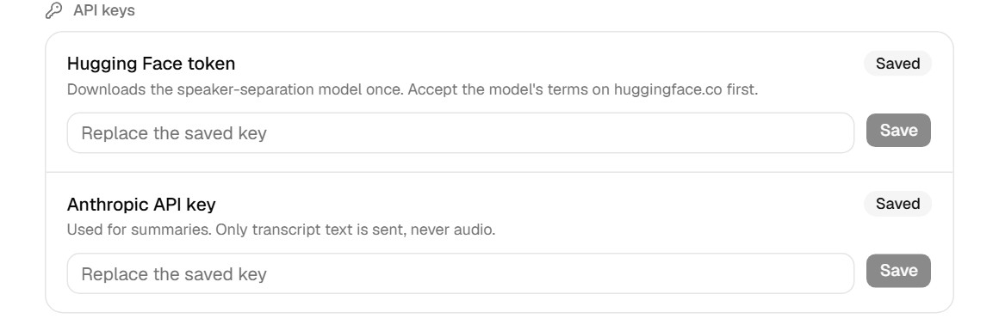
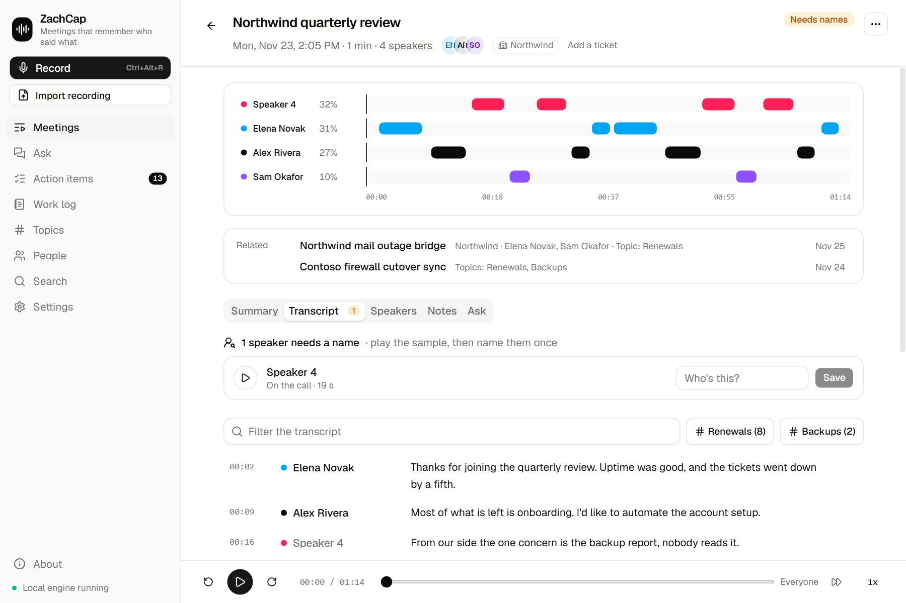

# Setting up ZachCap

From download to your first labeled call. The steps take a few minutes; the downloads take longer.

| What | Needed for | Cost |
|---|---|---|
| Windows 10 or 11, 64-bit, about 8 GB free | Everything | - |
| [A Hugging Face token](#2-hugging-face-token-tells-speakers-apart) | Telling the people on the call apart | Free |
| [An Anthropic API key](#3-anthropic-api-key-summaries-optional) | Summaries, action items, documents and questions by Claude | About $0.09 per hour-long meeting with Opus 5.5 |
| [Ollama](#4-ollama-summaries-on-this-pc-optional) | The same summaries and documents by a model on your PC | Free |
| An NVIDIA GPU with 4 GB or more | Speed. About 10 minutes of processing per meeting hour with one; about an hour on a 6-core laptop CPU without | - |

Only the first row is required. Without a token ZachCap still records and transcribes, labeling the two sides **You** and **Call audio**. Without a key or Ollama there are no summaries.

## 1. Install

1. Download `ZachCap_<version>_x64-setup.exe` from the [latest release](https://github.com/ZachGSnow/zachcap/releases/latest).
2. Optional: check it. `Get-FileHash .\ZachCap_<version>_x64-setup.exe` in PowerShell should show the SHA-256 in the release notes.
3. Run it. The installer isn't code-signed yet, so Windows SmartScreen may say it "protected your PC": choose **More info**, then **Run anyway**.
4. Press **Install**. It installs for your account only, without administrator rights, into `%LOCALAPPDATA%\Programs\ZachCap`.
5. The first start downloads Python and the speech libraries (about 4 GB) and takes a few minutes. Later starts take seconds.

The first call you process downloads the Whisper model too (about 1.6 GB).

## 2. Hugging Face token (tells speakers apart)

The speaker model, [pyannote speaker-diarization-community-1](https://huggingface.co/pyannote/speaker-diarization-community-1), is free, but its makers ask you to accept their conditions before it can be downloaded. The token lets ZachCap download it as you. It then runs on your PC, and no audio is uploaded.

1. Create a free account at [huggingface.co/join](https://huggingface.co/join) and confirm your email address.
2. Signed in, open the [model's page](https://huggingface.co/pyannote/speaker-diarization-community-1), fill in what it asks for and agree to the conditions. This shares your username and email with the model's makers, who say they may email you occasionally.
3. Open [huggingface.co/settings/tokens](https://huggingface.co/settings/tokens), create a new token, and choose the type **Read**. Any name will do.
4. Copy the token right away (it starts with `hf_`) and treat it like a password.
5. In ZachCap: **Settings > API keys > Hugging Face token**, paste it, **Save**.

"Saved" means stored, not tested. You know it works when a call shows separate speakers.

## 3. Anthropic API key (summaries, optional)

1. Sign in at [platform.claude.com](https://platform.claude.com) and set up billing. This is separate from a Claude subscription.
2. Create an API key and copy it.
3. In ZachCap: **Settings > API keys > Anthropic API key**, paste it, **Save**.

Only text is sent, never audio, and only when you ask for something. The model is yours to pick under **Settings > Summaries**.

## 4. Ollama (summaries on this PC, optional)

1. Install [Ollama](https://ollama.com).
2. In a terminal: `ollama pull qwen3.5:4b` (3.3 GB). It did best of the small models tried.
3. In ZachCap: **Settings > Summaries > Model on this PC**.

It writes slower and misses more than Claude does, but nothing leaves the PC. Private meetings are always left to it.

## 5. Before your first call

1. **Settings > You**: your name.
2. **Settings > Recording**: pick the microphone your call app uses, and run the **Sound check**. It says whether your side and the other side are both heard.
3. **Decide whether calls record themselves.** By default a recording starts when Microsoft Teams, 3CX, Zoom, Webex or RingCentral takes your microphone. To start them yourself, turn off **Record calls on their own** there. Calls in a web browser are only ever offered.
4. **Tell people you're recording.** Some places require everyone's consent. The recording bar copies a heads-up for the meeting chat.

After the call, name the voices ZachCap asks about. It recognizes them the next time.

## Updating and uninstalling

- **Update:** run a newer installer and press **Update**. Your meetings, voices and settings stay, and a recording in progress is saved. If Claude Desktop or Claude Code uses ZachCap's MCP server, restart it afterwards.
- **Uninstall:** Windows **Settings > Apps**. The program and its speech engine go; your data stays in `%LOCALAPPDATA%\ZachCap` until you delete that folder. Keys stay in Windows Credential Manager, under "ZachCap".

## If something goes wrong

| What you see | What to do |
|---|---|
| Only **You** and **Call audio** as speakers | Accept the model's conditions with the same account the token came from and save the token again. Then open the meeting, **...**, **Reprocess audio** |
| The engine doesn't start | Press **Try again**: it sets the engine up from scratch, mostly from what was downloaded before. The log is `engine.log` in `%LOCALAPPDATA%\ZachCap` |
| It mentions **Smart App Control** | ZachCap can't run while that is on, as it blocks parts of the speech libraries their makers didn't sign. It is under Windows Security > App & browser control. Turning it off lowers Windows' protection, and on some versions of Windows it can't be turned back on without resetting the PC |
| The other side isn't heard | Run the **Sound check**, and leave **Computer audio from** on every speaker and headset |
| Processing is slow | Without an NVIDIA GPU it is. **Settings > Transcription > Faster speaker separation** saves a third to a half of the time spent telling speakers apart |

Something else? [Open an issue](https://github.com/ZachGSnow/zachcap/issues) with the text from **About > Copy details**, which has nothing of yours in it.
